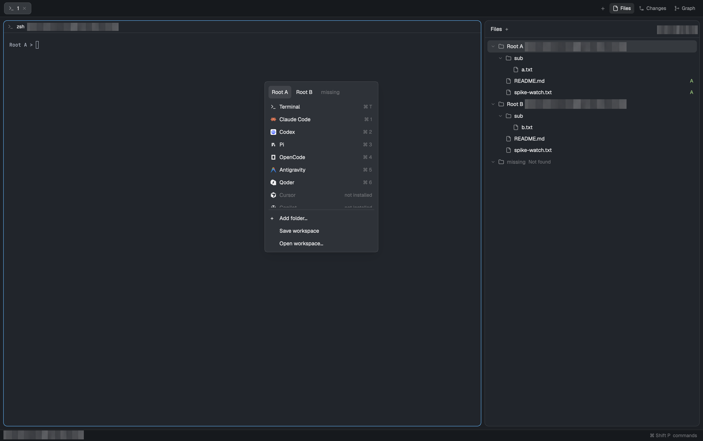

# herdr-mods

A collection of mods for [Herdr](https://github.com/herdrdev/herdr-app).

Each mod has its own top-level directory. Implemented mods include documentation, a preview image and installation files. Planned mods contain a documentation entry and an implementation plan. The directory structure follows [obrunogonzaga/herdr-mods](https://github.com/obrunogonzaga/herdr-mods).

## Mods

| Mod | Purpose | Status |
| --- | --- | --- |
| [Multi-Roots](multi-root/RECIPE.md) | Create multi-folder workspaces from the Spaces sidebar, browse roots together, choose terminal and agent roots, switch Git repositories, and save or reopen workspaces. | Available |
| [Files Plus](files-plus/README.md) | Combine single-folder and Multi-Roots file browsing with right-click file copy/paste, root-aware path copying, `@` agent reference insertion, Finder reveal, and file CRUD. | Planned |
| [Preview Plus](preview-plus/README.md) | View formatted Markdown, images, and PDF pages with Preview/Source toggle, relative link navigation, fit, zoom, and page controls; works standalone or with Files Plus. | Planned |

## Development

- [Development guide](CONTRIBUTING.md) covers directory structure, local API references and verification.
- [Credential management](docs/credentials.md) covers GitHub authentication and local configuration storage.
- [AGENTS.md](AGENTS.md) provides instructions for coding agents working in this repository.

Local Herdr documentation is at `~/.config/herdr-app/AGENTS.md`. Use the documentation and type definitions provided by the installed version.
