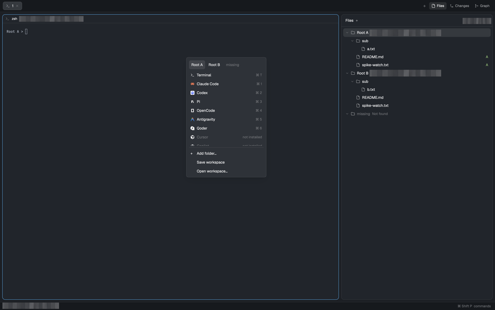

# herdr-mods

A collection of mods for [Herdr](https://github.com/herdrdev/herdr-app).

Each mod has its own top-level directory with documentation, a preview image and installation files. The directory structure follows [obrunogonzaga/herdr-mods](https://github.com/obrunogonzaga/herdr-mods).

## Mods

| Mod | Purpose |
| --- | --- |
| [Multi-Roots](multi-root/RECIPE.md) | Browse several roots in one space, launch terminals and agents in a chosen root, switch Git repositories, and save or reopen workspaces. |

## Development

- [Development guide](CONTRIBUTING.md) covers directory structure, local API references and verification.
- [Credential management](docs/credentials.md) covers GitHub authentication and local configuration storage.
- [AGENTS.md](AGENTS.md) provides instructions for coding agents working in this repository.

Local Herdr documentation is at `~/.config/herdr-app/AGENTS.md`. Use the documentation and type definitions provided by the installed version.
