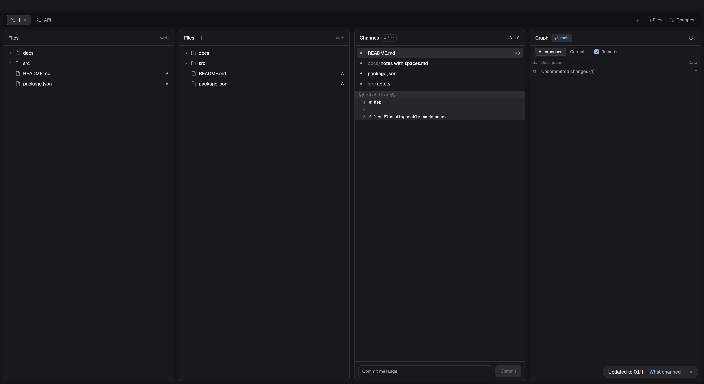

# Files Plus

Enhance the Files panel by combining single-folder and workspace browsing with a complete right-click file manager menu (Add to agent `@`, Copy, Paste, Copy path, Copy relative path, Reveal in Finder/Explorer, and file/folder CRUD). The header shows the current directory name. Its rightmost settings button chooses where file clicks open: a center Tab (default), a center Pane, or inside the right panel. Works standalone with built-in text previews, or uses [Preview Plus](../preview-plus/README.md) for Markdown, images, and PDFs.



See [the recipe](RECIPE.md) for installation, behavior, dependencies, limitations, and acceptance checks. The [implementation plan](../docs/plans/files-plus.md) records the shared contracts and implementation evidence.

Install only `mods/files-plus/` into your Herdr app home's `mods/`, after checking for a conflicting name. In a personal layout, replace the existing Files block's `content.mod` with `files-plus`, retaining its block id. Clone a bundled layout before editing it. No shortcut changes or other runtime mods are required.

`mod.open {name:"files-plus"}` opens an overlay; it does not replace the layout's Files panel. For the bundled `main`, use `layout.clone` to preserve its look and saved sizes, then point the personal copy's existing `files` block to `files-plus`. Keep the `files` block id so the tab bar's Files button continues to work.

Run the automated tests from the repository root with Node.js 22 or newer:

```sh
node --experimental-vm-modules --test files-plus/tests/*.test.mjs
herdr-app check files-plus/mods/files-plus
```

For native macOS acceptance in an isolated app home and core, run `node files-plus/tests/native-session.mjs`, then pass the printed `session.json` path to `node files-plus/tests/native-verify.mjs`. See the recipe for the remaining manual picker check and session cleanup.

Reuse one native test window for follow-up checks. Close each test window as soon as it is no longer needed with `HERDR_APP_HOME=<session-app-home> herdr-app do app.quit`; keep the person's normal window open. `native-verify.mjs <session.json> --installed` uses an already prepared runtime. `native-followup.mjs <session.json>` checks calibration, panel fitting, manual override, menus and dialogs in the foreground window. Continuous mouse drags remain a separate native interaction check.

For folder animation, launch `node files-plus/tests/native-session.mjs --motion`, then run `node files-plus/tests/native-motion.mjs <printed-base>`. The driver samples native row heights for expansion, collapse and reopening in single-file, empty and 120-file folders, including both sides of a retained chunk boundary. Each sampled row must produce intermediate heights and reach its final height. Run this in the foreground test window; an inactive window that does not produce frames cannot establish smooth motion. The session directory receives `motion-report.json` and an unedited `motion.png` capture.

Run verification only in the disposable Herdr home and core created by `native-session.mjs`. Never switch the working Herdr's layout, add verification spaces there, or install a candidate there to test it. The drivers reject session files pointing outside their disposable app home. After verification, close the test window and install the accepted runtime into the working Herdr. `--distinct-bundle` copies the unchanged signed app for separately targeted native input.

For a render comparison, extract the baseline runtime to a temporary directory and run `node --experimental-vm-modules files-plus/tests/benchmark.mjs <baseline-runtime>`. It alternates 20 samples per side, checks the 5,000-entry fixture and reports render work separately from native layout/GPU cost. `native-session.mjs --performance` and `native-performance.mjs <session.json>` collect real idle program calls over 60 seconds and expose the native FPS monitor. The root-owned `show_fps_monitor` API requires a ShellRoot unavailable in Herdr 0.1.11; the driver uses the documented inline `fps_monitor` instead.
