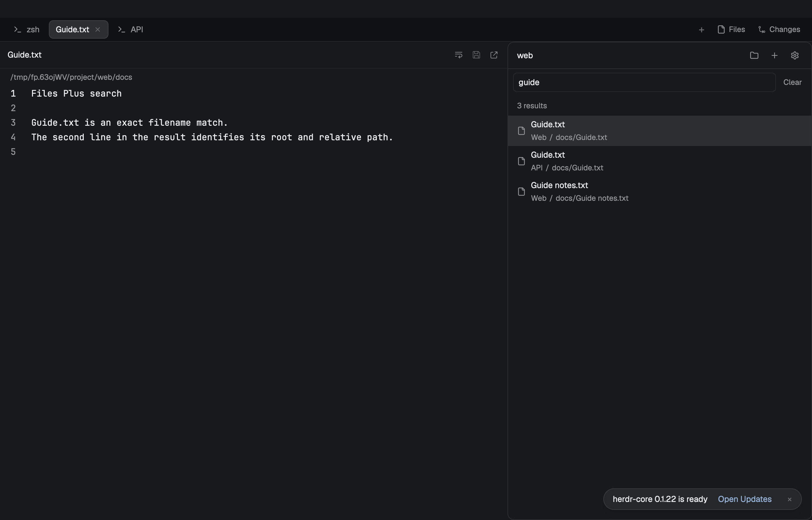

# Files Plus

Browse folders, search file names and paths, and manage files in Herdr's Files panel. Use one directory or a saved workspace with several roots. Right-click entries to copy, paste, rename, remove, reveal or add an `@` reference to an agent.



## Open and edit files

The header settings choose where files open. Tab is the default; Pane opens beside the current center pane; Inside right panel replaces the tree. Reopening the same path on the same machine focuses its existing file tab or pane.

With [Preview Plus](../preview-plus/README.md) installed, Tab and Pane send every file to it. Complete local UTF-8 text opens in its editor, including code, configuration, hidden files and files with unknown or no extensions. Markdown, JSON, CSV, TSV, supported images and PDFs have dedicated previews. Remote and truncated text remains read-only.

Inside right panel uses Preview Plus when both mods share a [layout stack](RECIPE.md#optional-preview-plus-pairing). Without that stack or without Preview Plus, the panel uses its built-in read-only source viewer. Files Plus also works alone.

## Search

Type in the field below the header to find files in unopened directories. Search ignores case. Exact names come first, followed by name prefixes and substrings. Use initials such as `fpc` for `FilePanelController.ts`, or type letters in order from the filename. For path searches such as `src/ report .ts`, all terms match literally and can appear in any order.

Search includes hidden and Git-ignored files, skips `.git` and does not follow directory symlinks. It ranks the scanned entries before showing up to 200 matches. Duplicate filenames and multi-root results show the root beside the relative path. A scan covers up to 10,000 entries or 256 folders and reports an incomplete search if it reaches a limit or a folder is unavailable.

Up/down selects a result. A click uses the chosen opening location. Enter uses the temporary Preview slot when paired; otherwise it uses the chosen location. Clear or Escape restores the tree with its expanded folders intact.

## Paste workspace roots to an agent

Focus an idle agent in a workspace with at least two distinct declared roots. Right-click a workspace root in Files Plus and choose **Paste workspace roots to agent**. The list goes into that agent's input as one editable line. Review it and submit it when ready.

## Multi-root agent context

While Files Plus is loaded, it sends existing and newly observed workspace agents the current root list and broadcasts later root additions or removals. Messages ask agents to inspect every root for applicable harness or instruction files rather than treating the terminal directory as the sole project root.

Delivery uses `hc send --if idle`: it submits a normal agent message, not a system-prompt injection or a permission change. Automatic delivery waits for an idle agent; working, blocked and done agents are left pending. The core repeats the idle guard immediately before typing, so a status change cannot steer an active turn. Unsent context remains pending; failed delivery reports the reason and can recover when the agent becomes eligible again. Multiple panel copies coordinate delivery rather than submitting duplicate messages.

Receipts are per observed terminal session, not per Codex or Claude conversation. Multi-root delivery supports local non-Windows workspaces only; Windows and remote workspaces are excluded.

## Keyboard workflow

Use the [Files / Preview / terminal example](../preview-plus/examples/files-preview-agent.json) with both packages. It contains no personal paths or shortcuts; copying or selecting it is an explicit setup action. The entry command `files-plus.search` focuses search. Bind it only to a free key in your own cloned layout/setup if desired.

| Focus | Key or command | Result |
| --- | --- | --- |
| Search | Up/down, Enter | Select a result and open a temporary preview |
| Tree | Up/down, Left/right, Enter | Select, collapse/expand, open a file |
| Files | F6 / `files-plus.preview` | Preview the selected item |
| Files | F7 / `files-plus.add-to-agent` | Explicitly paste `@` into the captured terminal |
| Preview | F7 / `preview-plus.pin` | Pin/unpin the paired slot; edits pin automatically |
| Preview | F6 / `preview-plus.back` | Back through history, then return to Files |
| Either | F8 / `<mod>.agent` | Focus the captured terminal |

These are local focus handlers, not global bindings. Modified function keys remain available to existing bindings. Files keeps its query, selection and expanded folders on return. A pinned paired file blocks replacement; save or confirm discard before unpinning a draft. Unpin keeps the current file until the next explicit selection. Tab/Pane previews remain fixed and existing same-machine files are reused.

`@` insertion quotes paths containing whitespace or quotes, preserves machine identity, restores the previous text clipboard if it still owns it, and never sends Enter. Paths containing control characters are refused. Native path dragging does not replace this action.

The paste target must still be the captured effective terminal (`shown || terminal`) after focus has yielded and immediately before paste. A shown replacement fails closed instead of receiving the reference.

## Install

Requires Herdr **0.1.16 or newer** for cancellable watches and native focus APIs. Use `${HERDR_APP_HOME:-$HOME/.config/herdr-app}` as the app home.

1. Check for an existing `mods/files-plus/`. For an update, back up the installed files and compare local changes before replacing them. Use another name for an unrelated mod.
2. Copy the runtime directory `mods/files-plus/`, including `LICENSE`, `THIRD_PARTY.md` and `licenses/`. Leave tests, generated type files and caches out.
3. Follow the [layout installation steps](RECIPE.md#installation) to replace the existing Files block without adding a second panel. Clone bundled layouts before editing them, and retain the `files` block id so the tab bar button still works.
4. Run `herdr-app check <app-home>/mods/files-plus` and inspect `herdr-app status`.

No shortcut changes or other mods are required. `mod.open {name:"files-plus"}` opens an overlay; replacing the Files panel requires the layout change above.

## Development checks

Run from the repository root with Node.js 22 or newer:

```sh
node --experimental-vm-modules --test files-plus/tests/*.test.mjs
herdr-app check files-plus/mods/files-plus
node files-plus/tests/check-search.mjs
```

For native checks on macOS, run `node files-plus/tests/native-session.mjs`. Add `--background` to launch and run `native-search.mjs` without activating the test window. Pass the printed `session.json` path to the relevant driver:

| Driver | Checks |
| --- | --- |
| `native-verify.mjs` | File operations, workspaces and previews. Use `--installed` to reuse a prepared runtime. |
| `native-search.mjs` | Search results, selection, empty/error states and truncation. |
| `native-followup.mjs` | Menu sizing, panel fitting, manual width overrides and dialogs. |

Run these scripts from `files-plus/tests/` or include that directory in the command. They call production handlers and render native views. Verify physical typing, arrows, Enter, Escape, clicks, drag completion and scrolling separately.

For folder motion, start `native-session.mjs --motion`, then run `native-motion.mjs <printed-base>`. It samples row heights through expansion, collapse and reopening. Keep the disposable window in the foreground so it produces frames. It writes `motion-report.json` and `motion.png`.

For a render comparison, run `node --experimental-vm-modules files-plus/tests/benchmark.mjs <baseline-runtime>`. It alternates 20 samples per version on a 5,000-entry fixture and reports JavaScript render work separately from native layout and GPU time. `native-session.mjs --performance` and `native-performance.mjs <session.json>` measure idle calls over 60 seconds using the inline FPS monitor.

Reuse the disposable app home and core for follow-up checks. Close the test window with `HERDR_APP_HOME=<session-app-home> herdr-app do app.quit`. Keep tests out of the normal app home. The optional `--distinct-bundle` flag copies the signed app unchanged for separately targeted native input.

The [recipe](RECIPE.md) defines behavior, dependencies and limits. The [search record](../docs/plans/files-plus.md#filename-and-path-search-2026-11-06) and [all-file editor record](../docs/plans/preview-plus.md#all-file-editor-routing-2026-11-06) contain the completed automated and isolated native checks. Physical input and additional platform/theme combinations remain unverified for these changes.

The [interaction/performance implementation record](../docs/plans/interaction-performance-implementation.md) records the 0.1.16 lifecycle, keyboard and Plugins checks separately, including remaining physical acceptance gaps.

## License

Original project contributions are licensed under [MIT](LICENSE). Third-party material retains its own licenses; see the [runtime notices](mods/files-plus/THIRD_PARTY.md). Keep the runtime `LICENSE`, `THIRD_PARTY.md` and any `licenses/` directory with installations and redistributions.

### Browse without changing the workspace

Use the header folder button (**Change folder…**) to browse a local folder without moving the terminal or adding workspace roots. The adjacent return button restores the terminal folder, or the original workspace roots. The **+** button still adds a workspace root. The browsing choice is remembered per space; remote system folder picking is not supported.

For isolated native browsing checks, run `node files-plus/tests/native-browsing.mjs <session.json>` after starting the disposable session described above. This exercises the production override/reset behavior, not physical interaction with the system picker.
