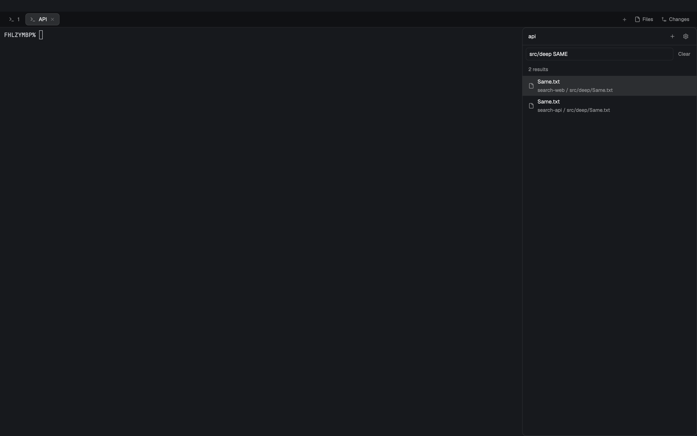

# Files Plus

Browse a single folder or every folder in a workspace in the Files panel. Find files by name or path, including unopened directories. Right-click an entry to insert an agent reference, copy it, paste it, copy an absolute or relative path, reveal it in Finder or File Explorer, or create, rename and remove files. A persistent + adds workspace folders, and root entries offer a dedicated root menu to launch terminals or remove folders. Drag any file or folder to insert an agent reference into the active terminal or agent. Adaptive fitting sizes the panel to content, context menus fit their text within window edges, and folders expand and collapse through native transitions. High-performance retained row chunking and incremental change tracking keep scrolling and tree updates fast. Files open in a center Tab by default; the header settings offer a center Pane or the right panel instead. Text uses the built-in read-only source viewer, with optional rich rendering through Preview Plus, including JSON, CSV and TSV in the combined community delivery.



The preview is an unedited `herdr-app shot` from a disposable native Herdr window showing the personal workspace sidebar, Files Plus, and Preview Plus Markdown/PDF panes. This package ships only Files Plus. All shown folders and documents are test fixtures. Preserve the capture's sRGB metadata.

## What you see

The panel defaults to 320px wide; its actual size belongs to the layout. The header shows the current directory basename, an Add folder control (`plus.svg`) and a settings button (`settings.svg`) at the far right. Long directory names truncate and expose their path in a tooltip; without a directory the title is Files. An internal preview adds a back control (`arrow-left.svg`) and a shortened preview path. Controls use SVGs with Herdr hover colors. The panel uses the shipped Files/Changes defaults: a 1px theme-colored border, 10px corners, a 42px header with a semibold title, 28px rows, 18px indentation per level and 6px tree padding. Body text is 13px; secondary labels are 12px. Icons are 12px chevrons and 14px file/folder glyphs. Roots show their display name and path, highlight the focused terminal's root, and show “Not found” for missing directories. The last activated file stays selected with a highlighted background after returning from preview. Git letters appear at the right of changed entries.

Dragging any file, folder or workspace root row at least 6px shows a floating `@` drag pill with the file or folder icon, entry basename and an `@` badge. When the pointer moves outside the Files panel, the pill updates its text to “Click to add @” with a copy cursor when a drop target is available, or a no-drop cursor when no terminal exists. The frameless floating overlay remains inside the Herdr window.

Pointer menus fit their longest label or status text using ASCII/CJK calibration probes in the native body and secondary text styles, with a 188px minimum and window-width cap. Measurement uses the same 13px body and 12px secondary sizes as rendering. Following Git Graph's integration approach, Herdr draws the standard popup/dialog border, corners and shadow. Menu rows use the native 30px height and 7px corners; dialog inputs are 36px high, buttons 32px high and both use 8px corners. Internal borders use the native 1px primitive and Herdr border/input colors. Menus clamp inside window edges in zoom-normalized coordinates. Errors widen and reopen the menu when needed. Name and confirmation dialogs fit the action and path, between 420px and 560px wide within the viewport, with room for native input, status and action controls. Disabled actions use Herdr's muted text; errors and progress stay visible.

Use theme-provided fields directly for their control roles; retain Herdr's shipped control defaults where no field exists. Herdr 0.1.11's `theme()` exposes colors, not a complete control stylesheet. The general `cx.theme()` typography, spacing and radius scale is not the style used by Herdr's Files/Changes/Graph panels and must not replace their defaults. `appearance.js` only reads colors from `theme()` and the UI font family from resolved `settings()`; it defines no palette or type/spacing/radius scale. All colors preserve transparency and user overrides. Source previews use Herdr's resolved code font/size and syntax colors. UI and code sizes receive zoom exactly once. Retained rows and open previews follow same-appearance color changes and configured font changes without rereading files. Herdr version changes require rechecking the shipped defaults; unexposed style constants cannot be synchronized automatically.

Buttons, menu entries and tree rows retain the default arrow pointer. Header controls have 6px corners and use Herdr hover/selected surfaces. Hover only changes the target's own styles; menu hover does not change keyboard selection through JavaScript. Disabled controls use `theme().dim`, keep the default pointer and have no hover action. Dialog primary buttons retain their fill/contrast colors and use 0.88 hover / 0.8 pressed opacity, like native Herdr prompts; destructive confirmations use the theme error color. Secondary buttons use hover/selected surfaces. Presses stop propagation to their container. Drag gestures retain their existing copy/no-drop/grabbing feedback.

The optional [sidebar pointer patch](patches/sidebar-default-pointer.patch) changes the existing personal `multi-root-spaces` clone's New multi-folder workspace button to the default pointer while preserving its native hover style. Apply it only to an already installed matching clone; the package does not reinstall that retired component or modify a bundled Spaces mod.

## How it behaves

### Tree browsing and virtualization

Folders load lazily, directories sort first, hidden entries are included and `.git` is omitted. Symlinks appear as files and are not recursively followed. Visible rows are flattened and partitioned into retained chunks of 100 rows in child views inside a native scrolling container. Scrolling executes entirely in native Rust with zero JavaScript calls per frame. Unrelated live updates (such as agent ticks or terminal output in other panes) rebuild zero tree rows.

Local safety polls run every 60 seconds while visible; remote folders poll every 10 seconds. Incremental filesystem watching via `watchFolder` maps changed paths back to their parent directories, debounces filesystem bursts by 200ms, lists at most four folders concurrently, and reloads only expanded affected folders. Internal `.git` lock churn is ignored, and Git status is throttled to once per repository every two seconds. Cached physical roots and repository discovery persist until context or config changes.

### Filename and path search

A 30px native input below the header searches files under the current single-folder root or every declared workspace root, including closed roots and unopened descendants. It uses 13px text, a 0.5px input border and existing Herdr theme colors. Results use 48px rows with a 13px basename and 12px relative path; multi-root results prefix that path with the root's display name. Duplicate display names use the logical root path instead. A tooltip preserves the full root, path and remote machine.

Whitespace-separated terms must all occur in the root-relative path, case-insensitively and in any order. Use `/` for path separators. Punctuation, glob characters and regex characters are literal; `src/ report .ts` is a path query, not a content query. Directories are traversed but are not results. Hidden and Git-ignored files, including dependencies, stay searchable, matching the tree policy. Entries named `.git` are excluded at every depth. Symlinks are listed as files and are not followed recursively; a declared root may itself be a logical alias.

The search scans complete directory listings, independently of the tree's 500-per-folder, 5,000-total and depth limits. It batches at most four directory reads per request and shows at most 200 matching files. Only a confirmed additional match produces “200+ results. Refine search.” Missing or unreadable directories show “Search incomplete” with details, while readable roots still contribute results. Large roots can take time, especially over a remote connection; results appear after the scan completes or reaches the result limit. There is no persistent index, content reading or new runtime dependency.

Typing is debounced by 180ms. New queries, changed roots/spaces/machines and closing the view invalidate pending replies. The query is re-run against changed roots; focus movement within an unchanged workspace retains it. Filesystem events and existing safety polls refresh an active search, including changes below unopened folders. A running scan finishes before a later poll can restart it; files changing during a scan are not an atomic snapshot and are picked up by subsequent refreshes.

Up/down moves the selection and scrolls it into view. Enter or a result click calls the existing file-open path, preserving machine/root identity, Tab/Pane reuse, Preview Plus handoff and the saved opening preference. Clear or Escape returns to the same retained tree and expansion state. An internal source preview's Back returns to the search first. Search adds no global shortcut or key binding.

### Built-in source preview and Preview Plus handoff

The settings button opens a 360×264px dialog with three choices: Tab in center panel (default), Pane in center panel, and Inside right panel. Selection saves immediately across panel copies and restarts. Up/down changes the selection; Done or Escape closes the dialog. The choice applies to subsequent file clicks.

Tab opens a mod-only tab named after the file in the captured space. Pane splits the captured center pane to the right; without a center pane, a notification asks the user to select one. Both keep the file and machine fixed even when focus changes. Ordinary text uses `files-plus` with `role: "preview"` and `{file, root, on}`; its read-only source view refreshes every ten seconds. Rich file types use Preview Plus with the same target props when installed, without requiring a layout stack. An unavailable receiver falls back to source.

Before opening, reuse an existing Files Plus or Preview Plus file Tab/Pane with the same full path and machine. Prefer a match in the current space, otherwise select its space and tab, reveal it if a sibling was zoomed, and focus its pane. This also applies after changing the opening preference. A closed preview does not prevent a new one. Read the core's `herdr-app` document using the read-only `doc.get` RPC through `hc connect`, and cross-check the target against live spaces, tabs and panes. This discovers previews opened before the mod reloaded without keeping a separate registry. If that lookup fails, show an error instead of opening a potential duplicate.

Inside right panel replaces the tree with a read-only syntax-highlighted source editor (`EditorState` with `readonly: true`). Back returns to the existing expanded tree and restores row selection. File changes refresh the tree, Git marks and an open preview. An unchanged file and look keep the existing editor and scroll state. A code-font or syntax-color change recreates the read-only editor from its cached text because Herdr exposes these options only at construction. Switching terminal focus within a workspace preserves expansions and previews.

In Inside right panel mode, when paired with Preview Plus via `props.previewStack` in a layout stack, clicking `.md`, `.markdown`, `.png`, `.jpg`, `.jpeg`, `.webp`, `.svg` or `.pdf` publishes the target `{ file, root, on }` to `shared("preview-plus.target")[spaceId]` and selects `preview-plus` in that stack. Ordinary text stays in Files Plus's built-in source editor. If Preview Plus is absent or not installed, rich files gracefully fall back to the built-in source editor.

### Native motion and transitions

Folder children expand from 0px to the native 28px row height and collapse back to 0px with native height and opacity transitions, using 250ms `ease-out`. Closing rows stay mounted for the transition and reject clicks and drags, while their directory state is released immediately. Reopening a folder retargets its existing rows; old cleanup callbacks cannot remove reopened children or affect another workspace. Loading and empty-folder placeholders use the same row motion.

Menus, dialogs, the drag pill and tree/source previews appear without custom entrance effects. Loading labels pulse natively. Each retained row chunk waits for the new rows' initial native size callbacks before changing their entrance targets. It coalesces mounted rows into one deferred update; a loading placeholder cannot start the entrance of replacement file rows before those rows have mounted. One cleanup callback releases outgoing rows after 250ms. Timers never animate individual frames. Motion uses Herdr's native GPUI engine; GSAP's `requestAnimationFrame`/`setTimeout` ticker is unavailable in this runtime. Panel resizing has no animated reflow.

### Right-click file manager menu

Right-click captures the entry, owning root, physical alias, machine and active terminal before the popup takes focus. Up/down arrows navigate items, Enter chooses, and Escape closes. Long-running actions keep their owner open until they finish; errors remain visible.

- **Add to agent (@)**: pastes a reference plus a trailing space into the captured terminal without Enter. Uses a path relative to the terminal's cwd only when that cwd and the entry belong to the same root and the entry is beneath the cwd; otherwise uses the absolute path so cross-root references remain unambiguous. Quotes whitespace, quotes and backslashes. Matches physical terminal cwd paths against declared workspace-root aliases. Refuses an unavailable captured terminal. Preserves and restores previous clipboard text, including an empty string.
- **Copy and Paste**: Copy writes the entry path, kind and machine to `shared("files-plus.clipboard")`. Paste targets the clicked directory or a file's parent, requires the same machine, and automatically chooses `name copy.ext`, `name copy 2.ext`, or the corresponding folder name when a collision exists. Existing files are never overwritten. Rejects directory cycles, including local/POSIX symlink aliases into the source directory. Copies symlinks as links.
- **Copy path and Copy relative path**: Copy path copies the absolute path. Copy relative path resolves relative to the entry's owning workspace root and yields `.` for a root row.
- **Reveal**: opens Finder on macOS (`open -R`), File Explorer on Windows (`explorer.exe /select`), or the local Linux file manager (`xdg-open`). Remote reveal is disabled.
- **New file and New folder**: prompts for a name inside the clicked directory or file's parent via a modal dialog. Rejects blank names, `.`/`..`, separators, control characters and existing entries.
- **Rename**: prefilled modal dialog renaming in place within the parent directory. Rejects collisions. Workspace roots cannot be renamed from this menu.
- **Move to Trash**: prompts for confirmation. Local macOS entries move safely to `~/.Trash` with collision-safe naming. Other platforms and remote machines display an explicit permanent-deletion confirmation dialog.
- **Root actions**: workspace root rows offer **New terminal here** (starts a terminal tab in the captured space and root) and **Remove from workspace** (removes the root from the workspace mapping without deleting files on disk; requires at least one root to remain).

### Drag to Agent (@) gesture

Drag a file, folder or workspace root at least 6px to show the floating `@` pill, then click outside Files to insert into the captured terminal without Enter. The pill shows “Click to add @” outside the panel. Click inside Files, Escape or right-click to cancel. Releases delivered to the floating surface also complete or cancel the operation; Herdr 0.1.11 can retain the original mouse grab, so click completion remains available.

When Files has keyboard focus, target capture inspects the active tab and picks in priority order: the focused terminal pane, then a running Agent pane, then its first terminal pane. Focus in another space never falls back. Herdr exposes no split-pane rectangles, so the drop destination is the captured terminal of the shown tab throughout the workspace area. The frameless floating overlay stays inside the app window.

### Multi-root workspaces and persistent + folder addition

Add folder works for local POSIX spaces, including ordinary single-folder spaces and preview headers. Captures the original space and displayed folder before opening the system picker. Cancel and duplicate selections leave data unchanged. Adding a different folder converts an ordinary space to an unsaved workspace, preserving its name, tabs and terminals.

Existing workspace files use a captured expected-text write: preserve path spelling, string entries, unknown fields and two-space formatting; new folders use relative paths. A conflicting disk edit reloads instead of overwriting the file. A closed or replaced target cannot be recreated by a late completion.

### Adaptive panel fitting

Set the panel block's props to `{ "fit": { "node": "panel", "min": 280, "max": 0.38 } }` to fit a known, named layout node. Without `fit.node`, Files Plus never resizes the layout. `max` is a window-width ratio for `0 < max <= 1`, or a logical pixel cap above 1; the default ratio is 0.38, with a 560px fallback when viewport dimensions are unavailable. Respect the node's own min/max and reserve 360px for the main workspace after the sidebar.

Measure the header and top-level rows with the same calibrated metrics as the menu, including icons, gaps and scrollbar space. Workspace mode measures root names and paths; single-folder mode measures direct entries. Expanded descendants never contribute to panel width, and long names truncate within the layout's width. Expanding and collapsing folders keep the divider in place. Debounce `layout.resize` by 250ms and ignore changes under 16px. Context changes may grow or shrink the panel; background top-level updates only grow it. Skip source previews and hidden panels. A divider resize differing from the last requested width by more than 4px pauses fitting until the space or workspace context changes. Normalize pointer and measurement coordinates by app zoom.

Agent working, blocked, done and idle displays remain the surrounding Herdr UI's responsibility.

## Built from

```text
files-plus/
  RECIPE.md
  README.md
  preview.png
  licenses/
  mods/files-plus/
    main.js, workspace.js, tree.js, metrics.js, fit.js, drag.js
    roots.js, config.js, actions.js, appearance.js, preferences.js, open-files.js, search.js
    mod.json, file.svg, folder.svg, chevron-down.svg, chevron-right.svg, arrow-left.svg, plus.svg, settings.svg
  tests/
```

Create `mods/files-plus/main.js` with a default-exported class that extends GPUI `View`. Route `props().role`: absent for the panel, `menu` for a pointer popup, `dialog` for a modal name, confirmation or root action, `settings` for the open-location dialog, `preview` for a fixed file viewer, and `drag` for the transparent full-window drag surface. Pass a captured target and an action into overlays. The overlay id comes from `props().overlay`.

Keep tree state, incremental local watchers, Git marks and read-only previews in `workspace.js`. `tree.js` flattens visible rows and retains groups of 100 rows in child views inside a native scrolling container. Unrelated live updates do not rebuild rows. Local safety polls run every 60 seconds while visible; remote folders poll every 10 seconds. Debounce filesystem bursts by 200ms, list at most four folders concurrently, and throttle Git status to once per repository every two seconds. Cache physical roots and repository discovery until context/config changes or missing-root recovery. Put path and workspace helpers in `roots.js`, guarded config saves in `config.js`, filesystem and terminal actions in `actions.js`, and direct Herdr appearance reads in `appearance.js`. Do not call `set_theme` or change the shared theme from this mod. There are no cross-mod code imports. The package manifest is:

```json
{
  "place": "right",
  "size": 320,
  "cloned_from": { "name": "files", "version": "0.1.9" }
}
```

No `keys.json` snippet is needed. Bind menu arrows, Enter and Escape to its focus handle; keep ordinary terminal shortcuts unchanged. `search.js` owns the independent scan, retained search input and virtual result list with a native scroll handle. It reuses `workspace.js` directory listing with the tree-only entry cap disabled; it never populates or expands the tree as a side effect.

The baseline is native Herdr 0.1.11. Use `cx.spawn`, `cx.timer`, `cx.sleep`, focus handles and clipboard APIs from GPUI; `EditorState`, `Editor`, `InputState`, `Input`, flex builders and SVGs from gpui-base/gpui-kit. Herdr provides live spaces/panes/focus/settings, `shared`, `setShared`, `exec`, `readTextFile`, `writeTextFile`, `watchFolder`, `pickFolder`, overlays and `run`. Commands are `pane.focus`, `terminal.paste`, `tab.new` and optional `layout.select`.

### Optional panel fitting

Set the panel block's props to `{ "fit": { "node": "panel", "min": 280, "max": 0.38 } }` to fit a known, named layout node. Without `fit.node`, Files Plus never resizes the layout. `max` is a window-width ratio for `0 < max <= 1`, or a logical pixel cap above 1; the default ratio is 0.38, with a 560px fallback when viewport dimensions are unavailable. Respect the node's own min/max and reserve 360px for the main workspace after the sidebar.

Use the top-level measurement and stable folder-expansion behavior described in **Adaptive panel fitting** above. Keep ratio/pixel caps, zoom normalization and manual divider overrides.

### Folder context and saved workspaces

In single-folder mode, use the active terminal's live `cwd`, then the active space's folder as fallback. Carry its machine name as `on`, with `null` for this computer. Include the space, cwd and machine in the context key. A changed context resets the tree and preview. Use absolute paths for entry, expansion and Git-mark keys in both modes.

A workspace is a local non-Windows space with a mapping in `shared("multi-root.spaces")`. Its folders replace the single cwd as the browsing roots. Keep expansion and preview state when terminal focus moves between those roots. Match the longest declared or physical root against the focused cwd when highlighting a root or formatting a reference.

Read portable workspace files named `<name>.herdr-workspace.json`:

```json
{
  "name": "Product",
  "folders": [
    { "path": "./web", "name": "Web" },
    { "path": "./api", "name": "API" },
    "./notes"
  ]
}
```

Require a `folders` array of path strings or objects with `path` and optional display `name`. Resolve relative paths from the config directory, expand `~`, normalize `.` and `..`, and keep the first occurrence of each resolved path. Keep missing roots visible. A missing workspace name defaults to the filename without its suffix. Invalid JSON or invalid fields preserve the last valid mapping and expose an error.

Use these persisted shared contracts. Compare values before writing, because a shared write redraws every mod:

```ts
"multi-root.spaces": Record<SpaceId, {
  name: string;
  file: string | null;
  folders: { name: string | null; path: string; source: string }[];
  error?: string;
}>
"multi-root.recent": string[]
"files-plus.clipboard": { path: string; kind: "file" | "dir" | "root"; on: string | null }
"files-plus.revision": number
"files-plus.open-location": "tab" | "pane" | "internal" // missing/invalid defaults to tab
"preview-plus.target": Record<SpaceId, { file: string; root: string; on: string | null }>
```

`path` is resolved and absolute; `source` retains the declared spelling. `file: null` denotes an unsaved workspace. Retain the ten most recent saved config paths. Prune closed workspace mappings only when `machines()` reports the local layout as ready.

Before a root action, capture the space and the config text. Preserve original string entries, path spellings and unknown fields when saving. Write new roots relative to the config directory, using two-space JSON and a trailing newline. Call `writeTextFile(file, text, expectedText)` once. If the expected text is stale, reload and report the conflict without retrying the write. Check the captured mapping before changing it; a late completion must not recreate a closed space.

### Loading and actions

Store loaded directories in a map and expanded folders in a set. Load a directory only when expanded. Share the 5,000-entry budget across roots, sort directories first, and do not traverse symlinks. On POSIX, list names with NUL delimiters so whitespace and newlines remain names. On Windows, use PowerShell literal-path operations. Read Git porcelain status per distinct repository and translate its paths back to declared root paths.

Use `watchFolder` on local roots and the config directory. Reload the config only for changes to its file. Poll remote folders through the 10-second refresh. Guard all asynchronous results with the captured context and request identity. Build `EditorState` with `readonly: true`; retain the existing editor if preview bytes have not changed. Handle missing, binary, unreadable and oversized files as visible states.

Capture `{space,path,kind,root,physicalRoot,on,active:{pane,terminal,cwd}|null}` before opening the popup. The physical root is derived data, never a saved workspace field. All actions use this target rather than the popup's current focus. For agent insertion, save the clipboard text, focus the captured terminal, yield with `cx.sleep(0)`, paste the quoted reference, yield again, then restore previous text if present. `run()` returns no completion result, so restoring the clipboard before that yield can paste the wrong bytes.

Use `cx.spawn` for slow work. Create focus handles, inputs and editors in `init`, events or asynchronous tasks, never during `render`. Each callback uses its own context. Release retained inputs and editors when the view closes. Keep an asynchronous menu action alive until completion, or transfer it to a dialog before closing the menu.

### Dependencies and access

POSIX operations use `sh`, `cp`, `mkdir`, `mv` and, after explicit confirmation outside local macOS Trash, `rm`. Git marks use Git with `--no-optional-locks -c core.fsmonitor=false -c diff.autoRefreshIndex=false`. Windows retains PowerShell folder listing and file commands. Existing file lookup uses the installed `hc connect` JSON-RPC interface through a fixed sh or PowerShell pipeline; remote document reads use the RPC's `on` parameter. Reveal uses `open -R`, `explorer.exe /select,…` or `xdg-open`. Paths and RPC data are arguments, never interpolated shell source.

The mod reads workspace directories and text files, writes only requested filesystem mutations and workspace-config updates, and reads optional mods' `mod.json` to detect their presence. Local macOS Trash uses the person's `~/.Trash`. Remote filesystem calls carry the captured `on` machine. No service credentials, network services, Node.js, DOM or `setTimeout` are used by the runtime. Node.js 22+ and Python 3 are development/test dependencies only.

### Installation

1. Read the installed Herdr guide. Use `HERDR_APP_HOME` when set, otherwise `~/.config/herdr-app`.
2. Check for a `mods/files-plus` name conflict. Copy only runtime `.js`, `.svg` and `mod.json` files; keep the third-party licenses with the distributed package. Leave tests, generated `.d.ts`, `jsconfig.json`, recipes and screenshots out of the runtime.
3. To replace an existing Files block, initially install with `place: "none"`. In a personal layout, set the block's `content.mod` to `files-plus`, retaining its id. Restore the packaged manifest after the block uses the new mod. This avoids a second automatically docked copy. Clone a bundled layout before editing it. No other mods or shortcut changes are required. To undo, restore the previous reference.
4. Run `herdr-app check <app-home>/mods/files-plus`, inspect `herdr-app status`, then try the actual panel.

### Optional Preview Plus pairing

Files Plus works alone. Preview Plus is an available separate package; installing Files Plus does not install it. To pair them, preserve the existing outer Files id and turn that node into this stack:

```json
{
  "id": "files", "type": "stack", "active": "files-plus-tree",
  "children": [
    { "id": "files-plus-tree", "type": "block", "content": { "mod": "files-plus", "props": { "previewStack": "files" } } },
    { "id": "preview-plus", "type": "block", "content": { "mod": "preview-plus", "props": { "previewStack": "files" } } }
  ]
}
```

With Inside right panel selected, both the prop and installed receiver, `.md`, `.markdown`, `.png`, `.jpg`, `.jpeg`, `.webp`, `.svg`, `.pdf`, `.json`, `.csv` and `.tsv` publish the captured target and select `preview-plus` in the combined community delivery. Ordinary text stays in Files Plus. The receiver returns with `layout.select {stack:"files",child:"files-plus-tree"}`. Files Plus retains its expansions while hidden. Without the receiver, fall back to source preview. Stale asynchronous reads and receiver checks cannot replace a newer selection or another space. JSON/CSV/TSV routing is the root-owned integration change `cee18f3`; the filename-search branch intentionally leaves the existing rich-extension list unchanged until integration.

### Attribution

The Files tree, editor and original SVGs derive from [Herdr files 0.1.9](https://github.com/herdrdev/herdr-app) (Apache-2.0). The settings SVG comes from Herdr 0.1.12's workspace-chrome Lucide icon. Preserve [the Herdr license](licenses/Herdr-APACHE-2.0.txt) and [Lucide/Feather notices](licenses/Lucide.txt). This retains third-party terms and does not choose a repository license.

Filename search takes interaction concepts from [cybertron288's filetree](https://github.com/cybertron288/herdr-mods/tree/main/filetree) and [Mantiq's Telescope](https://github.com/Mantiq-com/herdr-telescope): search alongside browsing and keyboard selection of file results. The implementation uses this package's existing listing and opening contracts. No source, assets or dependencies from those projects are copied.

## Watch out

Keep the inherited tree/preview limits: 500 entries per folder, 5,000 loaded tree entries across all roots, 40 nested tree levels, 400,000 preview characters and Herdr's 1 MiB text-read ceiling. Filename search has its separate 200-result bound and does not inherit the tree traversal limits. Binary, missing, unreadable and oversized files show explicit source-preview states. Preview Plus owns rich rendering, links, images, PDF conversion and structured-data views.

Workspace management supports local POSIX spaces; Windows and remote spaces retain single-folder browsing. Windows/Linux/remote native interactions need verification on those systems. Clipboard operations can restore previous text, but not a previous non-text clipboard. Tests do not install into the person's normal app home, replace their layout or change shortcuts.

## Done when

Build and exercise these observable behaviors using disposable folders:

1. `herdr-app check <app-home>/mods/files-plus` passes. The single-folder tree handles loading, empty, unreadable and missing states, hidden names and symlinks. Expanded directories respect the per-folder and total limits.
2. A directory name replaces the Files title, with settings at the far right. The settings dialog remembers Tab, Pane or Inside right panel. Default clicks open a center Tab; Pane splits the captured pane. Repeated clicks on the same path and machine select its existing Tab/Pane without adding one, including an existing preview in another space or created before reload. Closed previews can be opened again. Text and Markdown open as read-only source without Preview Plus. In internal mode, Back returns to the same tree. Binary, absent and oversized files show their own states. A file edit refreshes the preview; unchanged bytes retain the editor state.
3. A two-root saved workspace shows both trees, root names, Git marks and missing roots. Focus changes retain expansion and previews. An invalid config keeps the last valid roots with a visible error.
4. Same-root and cross-root agent references reach the captured terminal with the correct quoting and trailing space, without Enter. Previous clipboard text is restored. A closed terminal is refused.
5. Copy and Paste preserve the source and choose available copy names. A directory cannot be pasted into itself or through a symlink into a descendant. Cross-machine paste is disabled. Absolute and relative path copying uses the clicked entry's owning root.
6. New file, New folder, Rename, Trash confirmation and local reveal act on the clicked target and refresh the tree. Invalid or existing names are refused. Cancelling a dialog writes nothing. Root rename and deletion remain disabled.
7. The native folder picker can confirm and cancel. Duplicate selections leave the workspace unchanged. A different root extends the captured space even if focus moves elsewhere. Saving preserves custom fields, and a conflicting disk edit is not overwritten.
8. Root actions retain one root, leave removed roots' files intact, and launch a terminal in the captured root and space.
9. With a compatible Preview Plus receiver and stack, rich targets switch the panel and Back restores the existing tree. Ordinary text stays in the source editor. Missing receivers fall back to source; stale requests cannot replace a later selection. Rich rendering itself belongs to Preview Plus.
10. `herdr-app status` reports no mod or layout errors. Capture the running panel with `herdr-app shot preview.png`. Use disposable content and retain the native PNG color metadata. Ship this folder without a `layouts/` directory or unused key bindings.
11. Unrelated live updates rebuild no retained rows. Watches reload only expanded affected parents, lock churn does no work, unchanged data does not redraw, and loaded entries never exceed the budget.
12. Both menu kinds fit their text and remain inside window edges at 100% and zoomed scale. Herdr colors, configured UI/code fonts and native overlay frames apply to the relevant controls, including same-appearance theme changes. The panel border, corners, header, row sizes and title weight match shipped Files/Changes defaults at the same zoom; generic GPUI tokens cannot change them. An open source preview follows configured fonts without a file reread. Selection persists after Back. Opt-in fitting keeps width stable on folder toggles and respects ratio/pixel caps and manual divider overrides.
13. A short press remains a click. Drag to show the pill, then click outside Files to insert one reference without Enter and restore clipboard text; clicking inside, Escape and right-click cancel. Check direct release delivery on the installed Herdr version and retain click completion when the original view keeps the mouse grab.
14. Search finds unopened nested files, including beyond the tree entry/depth limits; identical relative paths across roots stay distinguishable. Literal terms, hidden/ignored policy, empty/error states and honest result truncation agree with the contract above. Delayed queries and changed roots cannot open stale targets. Native typing, arrows, Enter, result clicks, Clear and Escape work, and the original expanded tree survives. `node files-plus/tests/check-search.mjs` checks a populated native search description without starting a window; `native-search.mjs` prepares the separate runtime acceptance report.

The committed package also includes automated and isolated native test drivers. Their commands are in [README.md](README.md); they are development tools, not runtime dependencies. The 2026-11-06 search addition passed automated tests, mod checks and five native driver groups. The current preview shows multi-root search results. Real Files Plus handoffs to JSON/CSV/TSV previews also passed. Physical keyboard/pointer dispatch and additional platform/theme combinations remain unverified; see the [implementation plan](../docs/plans/files-plus.md#filename-and-path-search-2026-11-06).
