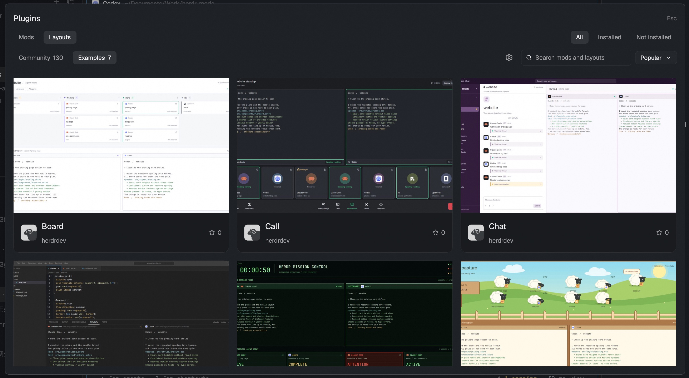

# Mods Plus

A native Herdr desktop mod and local package manager for browsing, installing, enabling, updating, and removing community mods and layouts.



See [the recipe](RECIPE.md) for detailed UI specifications, interactions, safety contracts, and acceptance checks. The [implementation plan](../docs/plans/mods-plus.md) defines the agreed release architecture.

## Features

- **Plugins Dialog**: Browse the official Community and Examples catalogs with large preview cards, author avatars, stars, local search and Popular / Newest sorting.
- **Mod and Layout Tabs**: Dedicated tabs with **All**, **Installed**, and **Not installed** filters. Installed packages appear first in **All**.
- **Separate Install and Activation**: Package files are staged, checked with `herdr-app check`, and recorded outside active directories until explicit **Enable** or **Use layout** is selected.
- **Reference-Safe Removal**: Inspects all local layouts before removing a mod. If an active layout still references a mod, removal is blocked with a guided cleanup prompt. Shared mods are retained.
- **Protected Updates**: Manual updates by default, with configurable background checks (1h, 6h, 12h, 24h). Update candidates are staged and checked first without modifying running files. Three-way merge protects local edits.
- **Details**: Large previews, descriptions, author information, a copyable installation prompt, source links, package actions and the rendered recipe.
- **Agent Integration Actions**: **Copy** copies the displayed installation prompt; **Open Agent tab** passes the fuller activation context to the configured agent.
- **Sidebar Plugins Entry**: A native icon-and-label row above Settings, with a synchronized update count on the right. A collapsed sidebar shows the count when updates are available and the icon otherwise.
- **Universal Shortcut**: Global shortcut (`Cmd+Shift+X` on macOS) to open the dialog from any layout.

## Installation

Run the provided installation script:

```sh
./mods-plus/install.sh
```

Or install manually:

1. Check `${HERDR_APP_HOME:-$HOME/.config/herdr-app}/mods/mods-plus` for conflicts.
2. Copy only `main.js`, `mod.json`, `helper.py`, `catalog.py` and `star.svg` into `mods/mods-plus/`. Python 3 and `curl` must be available.
3. In `keys.json`, add `"cmd-shift-x": "mod.open:mods-plus"` under `"global"`.
4. In your personal layout, set the `sidebar-footer` content to `{"mod":"mods-plus","props":{"entry":true,"footer":true}}` and its height to 97px. This footer contains Plugins, Settings and Add machine. Remove any previous header entry.
5. Verify the installation:
   ```sh
   herdr-app check ~/.config/herdr-app/mods/mods-plus
   ```

## Verification

Run the automated test suites:

```sh
# Unit tests
python3 mods-plus/tests/helper.test.py
python3 mods-plus/tests/catalog.test.py
python3 mods-plus/tests/updates.test.py

# Async UI event tests (Node.js 18+, no dependencies)
node --test mods-plus/tests/ui.test.cjs

# Acceptance test suite
python3 mods-plus/tests/acceptance.test.py

# Mod structure check
herdr-app check mods-plus/mods/mods-plus
```
