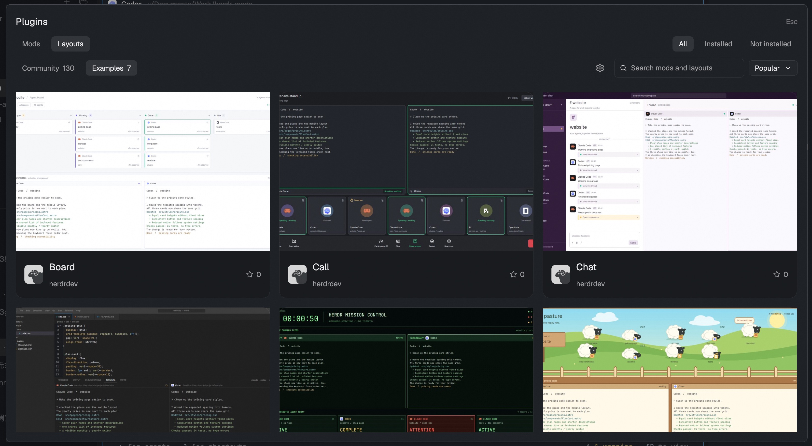

# Mods Plus

A comprehensive package manager dialog and entry mod for browsing, installing, enabling, updating, and removing community Herdr mods and layouts safely.

## What you see

- The sidebar footer shows Plugins above Settings and Add machine. Each row uses a 14px native icon, 13px text, 28px height and the native hover style. The 97px footer preserves update badges and hides labels when the sidebar is collapsed. The shortcut is preserved; there is no header entry.
- The dialog uses the native theme, 0.5px borders and four text sizes (12, 13, 16 and 28px). Mods / Layouts and All / Installed / Not installed occupy the first row.
- Community and Examples appear below with the official category counts. On the right, a settings icon sits immediately before search, followed by the Popular / Newest dropdown.
- Responsive one-to-three-column cards show a 16:10 preview, the author's avatar, title, author and stars. Installed and update markers sit at the right. Each page reveals 24 cards; images arrive four cards at a time. Unavailable images do not block later cards.
- Details show a large, uncropped preview above the title, author, stars and description. The adjacent Tell your agent box copies exactly its displayed installation prompt. GitHub links open the package's source folder. Package actions and the rendered recipe remain available below.
- Apply update and Remove sit beside the detail title using the Herdr theme accent and matching foreground colors. The action group wraps below the title on narrow panels. Remove keeps its existing second-click confirmation and uses the theme warning color while confirming.
- Settings has an automatic-check switch and a custom interval: a positive whole number followed by min / hr controls. Enter or leaving the number field saves the interval; clicking a unit saves the final number/unit pair. Existing hour settings are preserved. Saving disables repeated actions and displays failures. Loading and checking use native rotating indicators.
- Plugins shows a right-aligned count of verified update candidates. The count refreshes after automatic or manual checks, application and removal. In the collapsed rail the count replaces the Plugins icon when updates are available.
- Card status occupies one line: Update Available replaces Installed when a candidate is available. Settings uses an arrow-only Back button. The footer count uses a 12px-high badge and 8px text, reduced at the user's request.

## How it behaves

- **Bounded Tasks and Progressive Loading**:
  - Cached catalog entries appear before network refresh. Four official feeds refresh concurrently; media reads cached metadata without refreshing the feeds again.
  - Long helper operations run as one-shot tasks. Herdr's 30-second `exec` calls only start tasks and read their results; the view polls every 500ms while waiting. Matching in-flight requests share a task, including manual and scheduled update checks.
  - Each task has a five-minute deadline, native validation has a 45-second deadline, and each image request has a six-second deadline. Task timeout stops the helper process group. Failures include the operation name.
  - Closing a view stops its polling. An already-started task can finish within its deadline; no daemon schedules new work. Completed task receipts are retained for one day and cleaned on subsequent starts.
  - Candidate metadata is published atomically only after validation. Caught preparation failures remove their partial candidate without changing active files or recording a successful check. A hard-stopped task may leave partial files; they receive no badge and the next check replaces them.
- **Separation of Install and Activation**:
  - Clicking **Install** clones or downloads package files into `data/mods-plus/stage/`, runs `herdr-app check` on runtime mods, and saves verified files to `data/mods-plus/packages/<pkg-id>/`.
  - Files are kept outside `~/.config/herdr-app/mods/` and `layouts/` until the user explicitly selects **Enable** or **Use layout**.
- **Automatic Association without Manual Adopt**:
  - Scans installed files in `mods/` and `layouts/`.
  - Associates a complete package only when every upstream runtime file matches its git blob hash. Additional local caches and attribution files do not invalidate the match and are not added to the ownership baseline.
  - Previously verified ownership survives local edits. A record without staged or active entry files is not treated as installed.
  - Same-name collisions remain untouched. An offline verification failure is unknown, excluded from both Installed and Not installed, with an explanation in details.
- **Reference-Safe Removal**:
  - Before removing a mod, inspects all local layouts (`layouts/*.json`).
  - If any layout references the mod, deletion is blocked and a cleanup prompt is provided.
  - If a layout is removed, companion mods used by other layouts or packages are retained.
  - A recoverable backup of managed files is stored under `data/mods-plus/backups/<pkg-id>-<timestamp>/`.
- **Protected Updates and 3-Way Merge**:
  - Update checks download candidates into `data/mods-plus/updates/<pkg-id>/candidate/`.
  - Candidates are validated with `herdr-app check`.
  - A three-way merge check compares baseline hashes, local active files, and candidate files.
  - Local edits are preserved. If a conflict occurs, the candidate is held back without touching active files.
- **Scheduled Background Checks**:
  - While the layout with the Plugins entry is active, `cx.timer` checks for overdue work once per minute, supporting intervals as short as one minute.
  - Switching layouts or quitting Herdr pauses scheduling without background daemon services.
  - Up to four upstream lookups or package preparations run concurrently; packages sharing a source use one fresh tree lookup. A shared pool downloads up to eight files concurrently, including files within a single package. Checks bypass the catalog's cached tree. Failed packages are reported separately and never treated as up to date.
  - A completed check returns settings and verified candidate IDs together. Cards and the footer update in place without reloading the catalog or resetting the current search/filter.
  - Package mutations remain locked across helper processes. A lock timeout returns an error; it never proceeds unlocked. Catalog, details, settings reads and image downloads do not wait for package mutations. Newly verified ownership is saved under a short lock only if its prior record is unchanged; a busy operation defers that write.
- **Prompt Actions**:
  - The agent-tab activation prompt includes repository source, revision, installed paths, target app home, active layout name, recipe text, and validation instructions (`herdr-app check`).

## Built from

- **GPUI Elements**: `View`, `div`, `image`, `svg` from `gpui-kit`; `h_flex`, `v_flex`, `Input`, `InputState`, `Switch`, `TextView` from `gpui-base`.
- **Herdr APIs**: `exec`, `appHome`, `props`, `closeOverlay`, `notify`, `theme`, `window`, `run`, `knownAgents`, `shared`, `setShared`. Async settings and update actions receive the context from `cx.spawn`; native `spin` and opacity transitions provide feedback without animation timers.
- **Official Gallery**: `https://assets.herdr.dev/mods/index.json` and `https://assets.herdr.dev/layouts/index.json`. Examples use the cards embedded in `https://herdr.dev/mods/` and `https://herdr.dev/layouts/`, enriched with identities from those same indexes. Community previews use only the official moderated URLs; avatars use GitHub. Metadata is cached for one hour with stale-cache warnings on refresh failure. Search, status filters and sorting run locally.
- **Backend Helper**: `helper.py`, `catalog.py`, and `jobs.py` (Python 3.8+ standard library, `urllib.request`, `subprocess`, `hashlib`, `difflib`, `shutil`, `fcntl`).
- **Network transport**: `curl` is required for official catalog, preview and avatar requests. GitHub file evidence uses the existing GitHub API client. No credentials are sent to the gallery or avatar endpoints.
- **Icons**: bundled Herdr SVGs rendered through native `svg()`; the star outline is an original local SVG.
- **Data Storage**: `<appHome>/data/mods-plus/` for `packages.json`, `settings.json`, `cache/`, `stage/`, `packages/`, `updates/`, `backups/`, and bounded task receipts in `jobs/`.

## Watch out

- Never copy newly installed mods directly into `<appHome>/mods/` during installation; Herdr automatically docks new folders on appearance.
- Bundled Herdr mods and layouts (recorded in `installed.json`) must remain read-only and excluded from community package management.
- Always check layout references across all layout files before deleting any mod folder.

## Done when

1. `herdr-app check mods-plus/mods/mods-plus` passes.
2. `python3 mods-plus/tests/helper.test.py` passes.
3. `python3 mods-plus/tests/acceptance.test.py` and `python3 mods-plus/tests/catalog.test.py` pass.
4. The Plugins row renders above Settings, and the header has no duplicate entry.
5. The dialog opens via the button and via `Cmd+Shift+X`.
6. Catalog browsing, Mod/Layout tabs, and All/Installed/Not-installed filters work smoothly.
7. Install stages files safely without premature activation.
8. Enable and Use layout integrate the package correctly.
9. Prompt copy and Agent tab launch functions work as expected.
10. Mod removal is protected when layouts still reference the mod.
11. `python3 mods-plus/tests/updates.test.py` and `node --test mods-plus/tests/ui.test.cjs` pass (Node.js 18+ is needed only for the UI event tests).
12. `python3 mods-plus/tests/jobs.test.py` passes, including a real 31-second task after its launcher exits, duplicate requests, failed-task retry, and timeout cleanup of descendants.

## Repair verification

The gallery type repair filters example cards by their official `data-type`, with a new examples cache key to discard previously mixed classifications. The repository preview is now encoded as PNG, matching its filename. The official Mods Plus index currently omits `previewUrl`; publishing the corrected asset and upstream gallery reprocessing are still required before the community card can display it. The client retains the official moderated-preview policy.

On 2026-11-03, Herdr 0.1.12 passed the source and installed runtime checks. All 15 Python tests passed. Live catalog and local installation readbacks were checked, and native gallery/details renders were inspected. The preview image was updated by the user. Full pointer/keyboard acceptance remains pending; see the [repair record](../docs/plans/mods-plus.md#gallery-repair-verification-2026-11-03). No real user package was installed, removed or updated during these checks.

The subsequent update-check repair passes 20 Python tests and four JavaScript event tests, including parallel preparation with a failed source, stale candidate cleanup, lock exclusion, expiring click contexts, settings refresh and automatic/manual badge synchronization. Source and installed runtime checks pass on Herdr 0.1.12. Live pointer and animation acceptance remains unverified: the window capture returned a stale frame and native clicks returned `noWindowsAvailable`. The existing preview is retained because that capture does not show the repaired UI. See the [update repair record](../docs/plans/mods-plus.md#update-check-repair-2026-11-03).

The custom-interval and download-concurrency follow-up passes 23 Python tests and six JavaScript tests. A native settings-render fixture checks the actual switch and interval controls, in addition to the normal source check. A live-network comparison in disposable app homes took 22.93s before and 6.44s after, with matching candidate revisions/hashes, the same 21 uncached blob requests, two verified candidates and no check errors. This is one paired measurement, not a network latency guarantee. See the [follow-up record](../docs/plans/mods-plus.md#custom-interval-and-check-latency-2026-11-03).

The 2026-11-06 timeout repair passes 34 Python tests and nine JavaScript tests, plus source and installed native checks on Herdr 0.1.13. A real update check launched by the reloaded mod completed in 46.44 seconds without an exec timeout. All six installed runtime files match the task source. Live pointer and image inspection remains unavailable: window capture returns a stale frame and computer use reports `cgWindowNotFound`. See the [timeout repair record](../docs/plans/mods-plus.md#helper-timeout-repair-2026-11-06).
