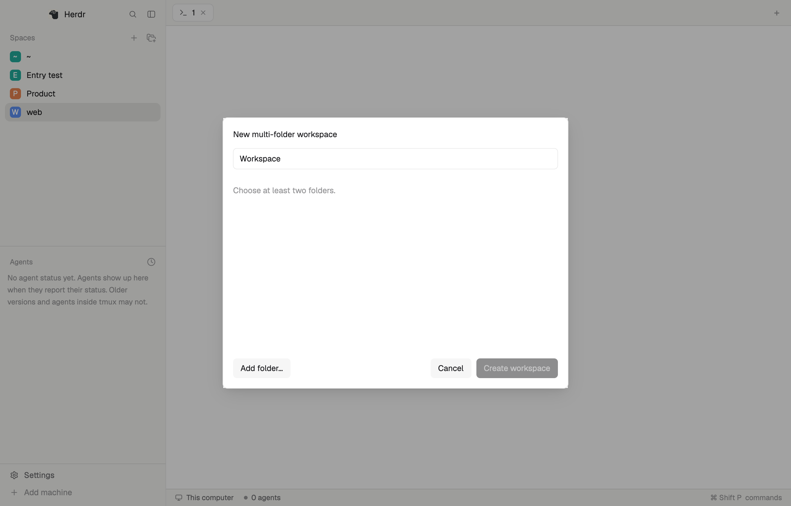

# Multi-Roots

Create a multi-folder workspace from the Spaces sidebar. Browse every root together, choose where terminals and coding agents start, switch the repository shown in Changes, and save or reopen the workspace from a JSON file.


The preview is captured from the running mod. Directory paths, the workspace name and personal status information are mosaiced; the interface outside those regions is unchanged. The PNG preserves the capture's sRGB color metadata.



The workspace dialog is an unedited `herdr-app shot` from an isolated Herdr 0.1.10 window with disposable folders. Its terminal block is hidden for the capture.

## What you see

- Spaces keeps its + button for a normal space and adds a stacked-folder icon with a + at the lower right and the tooltip “New multi-folder workspace”. The buttons sit side by side when expanded and vertically in the compact rail. The 560 × 440 creation dialog has a workspace name, a scrollable list of chosen folders, remove controls, Add folder, Cancel and Create workspace.
- Files stays in the existing Files panel. Each root row shows a chevron, folder icon, display name and shortened path. Roots start expanded. The focused terminal's root uses the selected color; a missing root says “Not found”. A file preview identifies its root and relative path in the header. A small + beside Files adds a folder.
- The 280 × 420 launch menu starts with wrapping root chips when there are at least two roots. Terminal and installed agents follow, then workspace actions. Missing roots cannot be selected; unavailable agents are dimmed.
- Changes stays in the existing Changes panel. Its repository switcher shows the display name, chevron and dimmed branch, beside file and line counts. The popup lists each repository once, with its branch, changed-file count and current selection.
- The 560 × 440 Open workspace dialog offers a folder picker and Recent files. Missing recent files are dimmed. Add, save and remove operations use a 460 × 240 dialog while a picker or file operation runs; an error remains visible there.

Use the person's Herdr theme: 13px body text, 12px secondary text, selected and hover backgrounds, and inherited 1px borders. The new name input uses a 0.5px border. Add no animation or decorative labels. Panel widths and the surrounding layout belong to the existing layout.

## How it behaves

The stacked-folder button creates a new local workspace independently of the selected space. Choose folders one at a time with the native picker; duplicate normalized paths appear once. Removing folders updates the draft. Create workspace requires a nonblank name and at least two folders. Cancellation creates nothing. Creation starts a terminal in the first available folder, attaches all chosen roots to the new space and restores its intended name. Existing spaces keep their mappings. The draft is persisted with `file: null`; use Save workspace later to write a portable config. No empty path is added to Recent. The button is hidden on Windows.

Open the menu with Cmd+Shift+T. The preselected root is the root requested by a root-row action, otherwise the focused terminal's root, otherwise the first existing folder. Left/right arrows move the selection. Cmd+T starts a terminal there; Cmd+1 through Cmd+9 start installed agents. These menu bindings are scoped to its focus. Outside the menu, Cmd+T keeps Herdr's normal new-terminal behavior.

Outside a workspace, “Make this space a workspace” uses the focused folder, then the space folder, then home. “Add folder…” uses the native folder picker. Right-clicking a root offers “New terminal or agent here…” and “Remove from workspace”; the last root cannot be removed. Close a popup before running its action. Picker and save operations belong to the dialog that remains alive for their completion.

Files retains the shipped lazy tree, folder-first sorting, Git marks, symlinks listed as files, local watches, 10-second refresh, read-only syntax-highlighted preview, back button and bounded loading. Switching terminal focus highlights a root without clearing expanded folders or the preview. A workspace-file change reloads while Files is shown, or after that copy has started in the current layout. Opening the menu also reloads it. Invalid configuration preserves the last good roots and displays the error in Files and the menu.

Changes retains the shipped status list, automatic first diff, virtual diff, untracked/binary previews, repositories without HEAD, commit input and Escape behavior, refresh and errors. Picking a repository stays in effect until focus moves to a terminal in a different root. Focus outside every root or on a mod pane changes nothing. A commit operates in the repository shown in the header. With no Git roots, show “No git repository in this workspace”.

Saving first asks for a directory and creates a lowercase, hyphenated workspace filename. Refuse an existing filename. Preserve original path spelling, string folder entries and unknown top-level/folder fields when saving an existing file; newly added folders use relative paths. Format with two spaces and a trailing newline. On a conflicting external edit, reload and show “The workspace file changed on disk. Reloaded.” without retrying the write.

Opening a directory with exactly one workspace file opens it immediately; otherwise list matching files, or “No workspace files in this folder”. Recent holds ten paths at most. An already open file selects its space. Closing and reopening restores the named space and roots; this saves folder configuration, not terminal commands or agent conversations.

Agent status displays remain Herdr's existing working, blocked, done and idle states. This mod adds no alternative status model.

## Built from

Ship this as one folder, with no `layouts/` directory:

```text
multi-root/
  RECIPE.md
  preview.png
  keys.json
  licenses/
  mods/
    multi-root/          main.js, config.js, roots.js, mod.json
    multi-root-files/    main.js, workspace.js, roots.js, mod.json, four SVGs
    multi-root-changes/  main.js, workspace.js, roots.js, mod.json
    multi-root-spaces/   main.js, mod.json, folders-plus.svg
```

All four default exports extend GPUI `View`; Files and Changes inherit their workspace helpers. This is native GPUI JavaScript, with no DOM, Node APIs or `setTimeout`. Use `cx.spawn` for asynchronous work and `cx.timer` for refresh, without retaining callback contexts.

### Runtime responsibilities

- `multi-root/main.js` adapts the shipped `new-menu`. Roles from `props().role` are the default launch menu, `create`, `open`, `root-menu` and `repo-menu`. The `create` role owns the name and folder draft and reuses the deferred space-attachment flow used when opening a config. The `open` role also owns add/save/remove actions. Use native overlays and folder pickers; use scoped GPUI key bindings for launch shortcuts so the global tab bindings do not intercept them. `config.js` performs atomic saves.
- `multi-root-spaces` is a `mod.clone` of shipped `spaces` 0.1.10. Preserve machine groups, folding, space selection, context menus, dragging, Git state and stored avatar colors. Change the header to add the creation button and stack its controls in the compact rail. Draw its custom `folders-plus.svg` at 16px with the current theme color. Raise inherited text below 12px and replace the Git detail middle-dot separator with a slash.
- `multi-root-files` is a `mod.clone` of shipped `files`. Keep upstream changes small: delegate workspace context, root rows and watches to `workspace.js`, use absolute entry/expanded-folder/Git-mark/element keys, and read a preview by its absolute path. Each root starts expanded. Git discovery runs once per root, with one status read per distinct top level. The 5,000-entry budget is shared across roots.
- `multi-root-changes` is a `mod.clone` of shipped `changes`. `workspace.js` chooses the initial focused repository or first Git root, remembers the last matched focus root, updates selection when that root changes, and draws the header switcher. Include the selected repository in the context key; preserve the upstream commit context check.
- The menu, Files and Changes each have the same `roots.js`: normalized/relative paths, longest-root matching, physical-path discovery, parsing, guarded shared-state updates, pruning, config reload and Git discovery. Mods exchange data through `shared()`, without importing one another.

Preserve the existing layout block ids `spaces`, `files` and `changes`; only their `content.mod` values change during installation. The tab bar's existing `layout.select` calls then continue working. Do not modify Git Graph or ship a layout.

### Data and files

A workspace file is named `<name>.herdr-workspace.json` and may live anywhere on the local machine:

```json
{
  "name": "Product",
  "folders": [
    { "path": "../frontend", "name": "Web" },
    { "path": "../backend", "name": "API" },
    "./notes"
  ]
}
```

The name defaults to the filename without its suffix. Folder names are display names only. Accept folder objects or path strings, absolute paths and `~`; resolve relative paths from the config directory, normalize `.`/`..`, and drop duplicate resolved paths while keeping the first. Keep missing directories in the list. Invalid JSON or a missing folders array keeps the last valid state.

Workspace data uses three persisted shared keys, comparing values before `setShared`. The Spaces clone also preserves upstream `space.colors` and its per-copy `machines.folded` local storage:

```ts
"multi-root.spaces": Record<SpaceId, {
  name: string;
  file: string | null;
  folders: { name: string | null; path: string; source: string }[];
  error?: string;
}>
"multi-root.repo": Record<SpaceId, { root: string; by: "focus" | "pick" }>
"multi-root.recent": string[]
```

`path` is resolved and absolute; `source` keeps the declared text. Workspace mode requires a mapped space on the local machine and a non-Windows platform. Otherwise retain the original panels and launch menu. Prune closed-space entries only after `machines()` reports the local layout as ready, because `spaces()` can be incomplete while loading.

Read/parse the config before opening. Compare with current mappings to avoid duplicate spaces. Create a named space using the first existing root or home. Since `run("space.new", …)` has no returned id and the immediate space list is stale, compare id sets on the next render, matching a unique temporary name, attach the workspace and rename to its intended name.

Use `writeTextFile(file, text, expected)` with the last text read. Keep raw objects when updating folders so unknown fields survive. Files watches each existing root and the config directory; re-read only when the reported path is the config file. Physical root paths stay in derived data for cwd/Git matching, without replacing declared paths in persisted state.

### APIs and dependencies

Use Herdr's live `spaces`, `machines`, `panes`, `focused`, `window`, `props`, `theme`, `settings`, `home`, `shared`, `setShared`, `knownAgents`, `pickFolder`, `readTextFile`, `writeTextFile`, `watchFolder`, `exec`, `run`, `openOverlay` and `closeOverlay`. Use `space.new`, `space.select`, `space.rename` and `tab.new {space, folder, name?, argv?}`. The replacement panels retain the upstream GPUI editor, input and virtual list.

The baseline is Herdr 0.1.10 with Git and POSIX `sh`; the menu and Files/Changes retain their 0.1.9 upstream bases. The new controls use 0.1.10's tooltip and accessibility APIs. Local workspace operations read config/root directories and invoke Git with `--no-optional-locks -c core.fsmonitor=false -c diff.autoRefreshIndex=false`. The Spaces clone retains the upstream `hc machine ls`, read-only Git discovery and local Git-directory watches. The Changes submit action runs `git add -A` and `git commit -m`. The inherited panels keep remote `exec` routing and Windows PowerShell listing outside workspace mode. There are no mod network calls or service credentials. Started agents use their existing launch commands and authentication.

### Installation and sharing

1. Read the installed Herdr guide and use `HERDR_APP_HOME` when set, otherwise `~/.config/herdr-app`.
2. Check for conflicting runtime names. Copy only `.js`, `mod.json` and required `.svg` files from the four runtime folders. Omit generated `.d.ts` files, `jsconfig.json`, the recipe and previews from runtime folders.
3. Confirm Cmd+Shift+T is unbound, then merge the single global entry in `keys.json`. Preserve every existing binding, including Cmd+T.
4. In a personal layout, set block `spaces` to mod `multi-root-spaces`, block `files` to mod `multi-root-files` and block `changes` to mod `multi-root-changes`, keeping their block ids. For a shipped layout, first use `layout.clone`, then edit the clone. An existing Multi-Roots installation only needs the menu update, the new Spaces runtime and the `spaces` reference change; its shortcut and two panel references stay as configured.
5. Run native checks, inspect `herdr-app status` and any keys/layout errors, then exercise the actual window. To undo, restore the original three mod references and remove only the added shortcut; workspace files remain ordinary JSON.

Publish the complete folder in a public repository with the `herdr-mod` topic. The [Herdr catalog](https://herdr.dev/mods/) indexes community entries within an hour; community preview images are screened before they appear. Updated images become visible after the catalog refreshes its preview URL.

### Attribution

The panels, Spaces sidebar and menu structure come from [Herdr](https://github.com/herdrdev/herdr-app), under Apache-2.0. Files includes Lucide/Feather icons. Retain [the Herdr license](licenses/Herdr-APACHE-2.0.txt) and [icon notices](licenses/Lucide.txt). These are third-party terms, not a choice of repository license.

| Upstream base | Version | `main.js` hash in `installed.json` |
| --- | --- | --- |
| `files` | 0.1.9 | `185dc12154f2bcf5` |
| `changes` | 0.1.9 | `b00568f69f7b7ff9` |
| `new-menu` | 0.1.9 | `74dc103b6b6113b7` |
| `spaces` | 0.1.10 | `9b8249038d8a6a9c` |

## Watch out

- The four initial spikes confirmed deferred space creation, native writes outside the app home, physical cwd paths through symlinks, and stable concurrent folder watches. Keep the implementation choices above when rebuilding.
- Local POSIX workspace support is the first-version scope. Remote spaces and Windows retain the upstream behavior.
- Keep the upstream limits: 500 entries per directory, 5,000 total tree entries, 1,000 changed files, 400,000 preview characters and 1,500 diff rows. Preserve binary/unreadable previews, repositories without HEAD, error/loading/empty states and read-only Git flags.
- Raise inherited 10/11px text to 12px; remove middle-dot separators. Keep inherited borders and theme colors.
- Clones do not follow Herdr upgrades. Diff against the recorded bases when updating and keep all three `roots.js` copies identical.
- On this macOS Herdr 0.1.9 installation, native `check` aborts with GPUI `window.rs:5226` `Option::unwrap()` for both the unchanged shipped `changes` and the clone. Live rendering works. Record this as an upstream check limitation, never a passing check; add no checker-only product workaround.

## Done when

Rebuild and verify the observable behavior below. Checks 1–8 describe the original Herdr 0.1.9 acceptance on macOS 27.0.1. The sidebar addition in check 9 was exercised in Herdr 0.1.10 with an isolated app home and core; no extra test suite or runtime test commands are shipped.

1. A workspace with relative, absolute and missing roots shows all roots, both existing trees and Git marks, plus “Not found”.
2. Expanded folders and the preview stay when focusing terminals in either root or outside every root. A preview identifies its root and relative path.
3. Conversion, native Add folder and save work. Selecting another root and an installed agent creates a tab in that root. Cmd+T outside the menu still creates a terminal directly.
4. Changes shows the chosen repository, branch, files and diff. A submitted commit lands only in the shown repository. Moving focus between roots updates selection; duplicate Git roots appear once and no Git roots show the specified empty state.
5. Saving preserves original paths, display names and unknown fields. An external edit blocks a stale save without being overwritten. Invalid config retains the last valid folders with a visible error.
6. Reopening selects an existing mapping, or restores the same named roots after closing. Restarting Herdr retains the mapping while existing core terminals remain live.
7. Non-workspace panels and the remote launch menu retain upstream behavior. The live app reports no mod or layout errors and an actual screenshot is captured with `herdr-app shot`.
8. Native checks for the menu and Files pass. The Changes check has the reproduced upstream limitation described above; it has not been claimed as passed.
9. In the expanded and compact sidebar, the stacked-folder button opens the creation dialog. Empty names and fewer than two folders disable creation. Native folder selection, duplicate rejection and root removal work. Creating Product with Web/API roots yields one new named space, one unsaved workspace mapping and both roots in Files, without a Recent entry. Cancel leaves the space count unchanged; the original + still creates an ordinary space without a workspace mapping. Native `check` passes for all four runtimes on 0.1.10; this also resolves the historical Changes check limitation for this environment. Live `status` reports no errors. `workspace-preview.png` is the actual native capture. Windows and remote-machine interactions were not exercised for this addition.
