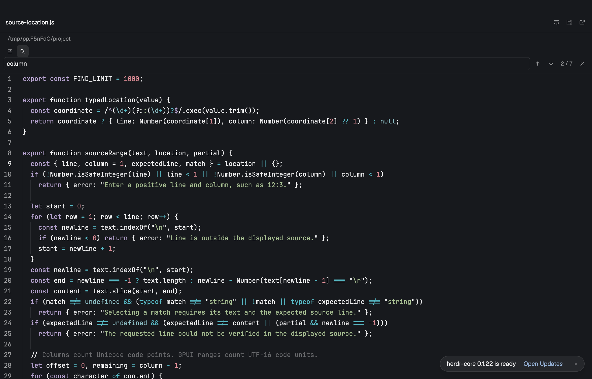

# Preview Plus

Edit local text files and preview Markdown, JSON, CSV, TSV, images and PDFs inside Herdr. Markdown has a table of contents, heading links and native Mermaid diagrams. Save checks for external changes before writing and keeps unsaved drafts when a conflict occurs.



Preview Plus works without Files Plus. It can replace the standard single-folder Files panel, open a file through `pane.split` or `tab.new`, or receive selected files from [Files Plus](../files-plus/RECIPE.md).

See the [recipe](RECIPE.md) for behavior, dependencies and verification. The [implementation record](../docs/plans/preview-plus.md) contains the shared target contract and verification results.

## Install

Requires Herdr **0.1.16 or newer** for cancellable watches; the current lifecycle checks use 0.1.16 on macOS. Media uses built-in Foundation, AppKit and PDFKit through `osascript`. Linux images require `python3`; Windows images require Python 3 as `python`. Mermaid uses a bundled renderer and needs no Node.js or browser at runtime. No service credentials are required. The [recipe](RECIPE.md#built-from) lists the required Herdr APIs.

1. Check `${HERDR_APP_HOME:-$HOME/.config/herdr-app}/mods/preview-plus` for a name conflict. For an update, back up the installed files and compare local changes before replacing them. Use another name for an unrelated mod.
2. Copy `mods/preview-plus/`, including `mermaid.bundle.js`, `LICENSE`, `THIRD_PARTY.md` and its `licenses/`, into the app home's `mods/`. Do not copy `tests/`, `node_modules/`, generated type files or `.cache/`. Keep the package's existing `licenses/` with any redistribution too.
3. Run `herdr-app check <app-home>/mods/preview-plus`.
4. Use one of the three setups below. Clone a shipped layout with `herdr-app do layout.clone '{"name":"main","as":"my-preview"}'` before editing its structure. Preserve the surrounding Files/Changes block ids, sizes, visibility and shortcuts.

### Standalone Files panel

In a personal layout, change only the existing `files` block's content:

```json
{ "mod": "preview-plus" }
```

The focused terminal's folder appears as a lazy tree. Opening a file replaces the tree in place. Back walks followed links first, then restores the expanded tree.

### Pair with Files Plus

Files Plus sends every file type to Preview Plus. Its Tab and Pane destinations need no layout stack. To use Inside right panel, install [Files Plus](../files-plus/README.md) and replace the existing `files` block with this stack. Carry over the original block's layout sizing properties. Keep the outer `panel-body` stack and its `changes` child unchanged.

```json
{
  "id": "files",
  "type": "stack",
  "active": "files-plus-tree",
  "children": [
    {
      "id": "files-plus-tree",
      "type": "block",
      "content": { "mod": "files-plus", "props": { "previewStack": "files" } }
    },
    {
      "id": "preview-plus",
      "type": "block",
      "content": { "mod": "preview-plus", "props": { "previewStack": "files" } }
    }
  ]
}
```

Pointer opening uses this stack with Inside right panel selected. Keyboard Enter/F6 uses it as a temporary slot independently of that preference. Tab remains the pointer default. The target carries file/root/machine plus a selection identity and captured terminal; Preview Plus chooses the existing editor or preview. Update both packages together.

The complete [example layout](examples/files-preview-agent.json) keeps spaces, tabs, an active terminal and the paired slot together without personal paths or shortcuts. Copy it under a new name only in an explicitly selected app home; select it there with `herdr-app do layout.switch '{"name":"files-preview-agent"}'`. It does not merge into a personal layout automatically.

### Temporary and pinned preview

Recovery polling compares local media metadata before reloading. Unchanged images/PDFs keep pan, zoom, page, focus and the loaded media; explicit Refresh still reloads. Unsupported remote media retains its visible error instead of being reset every ten seconds. Watch warnings belong to current dependency directories and disappear when the failed dependency is removed.

F7 or Pin freezes the paired slot on its current file. Editing pins it automatically, including recovered drafts. Browsing another file cannot replace a pinned slot; save or confirm discard, then unpin. Unpin keeps the current file until a new explicit selection. Pinning creates no extra tab/pane. Fixed Tab/Pane files retain their existing behavior and same-machine reuse.

With Preview focused, F6 returns through history to Files; while pinned, cross-file Back returns to Files without replacing the pinned file. F8 focuses the terminal captured by Files. `preview-plus.focus`, `.pin` and `.agent` expose the same operations. The [Files keyboard table](../files-plus/README.md#keyboard-workflow) includes search/selection and explicit safe `@` insertion. No global bindings are installed.

### Standalone pane or tab

Use an absolute file path; `root` defaults to the file's directory and `on` defaults to `null`:

```sh
herdr-app do pane.split '{"direction":"right","mod":"preview-plus","props":{"file":"/absolute/path/README.md"}}'
herdr-app do tab.new '{"name":"Document","mod":"preview-plus","props":{"file":"/absolute/path/guide.pdf"}}'
```

Pass `on` with the machine name for remote Markdown and text. Images and PDFs are local-only by default. PDF rendering is macOS-only; the Open control can launch a local PDF in its system application on other platforms.

### Opt-in local copies of remote images and PDFs

For a folder synchronized by another tool, set `localSyncRoots` on the receiving Preview Plus instance. The default is an empty list. For a paired panel, add the setting to Preview Plus's content props.

```json
{
  "mod": "preview-plus",
  "props": {
    "previewStack": "files",
    "localSyncRoots": ["/absolute/path/to/synchronized-folder"]
  }
}
```

For a fixed pane or tab, include the same setting with `file` and `on`.

```sh
herdr-app do tab.new '{"name":"Synced image","mod":"preview-plus","props":{"file":"/absolute/path/to/synchronized-folder/photo.png","on":"other-machine","localSyncRoots":["/absolute/path/to/synchronized-folder"]}}'
```

The remote target must use the same absolute path as the local copy, under a configured root. Use physical paths throughout. Symbolic links in the root, its parents or within it are refused, including links that point back inside the root. Sync copies support images and PDFs on macOS, and images on Linux with Python 3. Windows continues to preview its ordinary local images.

The preview shows **Local copy** and warns that contents may differ. Sync status is unverified. A missing or unreadable copy shows an error. The remote machine still owns the target and Open stays disabled. Files Plus's external Open, Reveal and double-click behavior, and inline images in remote Markdown, retain their existing behavior.

### Source locations for callers

For a new viewer, pass an optional `location: { line, column? }` inside the existing `pane.split` or `tab.new` props. Preview opens in Source and applies the position once when the editor is ready. This command opens line 42, column 3.

```sh
herdr-app do pane.split '{"direction":"right","mod":"preview-plus","props":{"file":"/absolute/path/README.md","location":{"line":42,"column":3}}}'
```

Use one-based physical lines and Unicode code-point columns. A tab, a supplementary character such as 😀, and a combining mark each count as one column. Columns start at 1 and include the position after the last character. LF and CRLF each end one line. Preview converts these coordinates to the native editor's zero-based UTF-16 offsets. Invalid coordinates leave the caret where it is and show an error. Callers with UTF-8 byte offsets or UTF-16 columns must convert them.

To select a literal hit, include `expectedLine` with the full original line, excluding its line ending, and `match` with the exact text at the requested column. Both must agree with the displayed buffer, including any unsaved draft. Preview reports a mismatch and leaves the selection alone. A partial final line from a truncated preview cannot verify a hit.

To reuse a fixed pane or tab, give it `space` and a caller-generated unique `viewer` string at creation. After selecting its workspace and tab, send this mod command. The caller resolves or creates the viewer using its usual placement rules.

```js
const request = {
  space, tab, viewer, file, on: null,
  location: { line: 42, column: 3 }
};
run("preview-plus.locate:" + encodeURIComponent(JSON.stringify(request)));
```

`space` and `tab` are the visible Herdr IDs, `file` is absolute, and `on` is the file's machine name or explicit `null` for local. `viewer` identifies a single fixed copy even when two panes show the same file. For a paired slot, use `stack` and `selection` in place of `viewer`. Publish the file using the existing `preview-plus.target[space]` handoff with a fresh `selection` for each open, show the paired slot, and send the command with that selection. A different pinned file stays in place. When using the CLI, pass the full encoded command as the name after `herdr-app do`.

## Edit and save

Ordinary local text opens in the native editor regardless of its extension. This includes code, configuration, hidden files and extensionless files. Markdown, JSON, CSV and TSV open in Preview; the code icon switches to Source, and the eye icon returns to Preview. Files Plus uses the same editor in Tab, Pane and paired panel mode.

The toolbar has Wrap lines, Save and Open controls with tooltips. Wrap lines is enabled in Source and disabled in Preview. A dot beside the filename marks unsaved changes. Save with the disk icon or, while the editor has focus, `Cmd+S` on macOS and `Ctrl+S` elsewhere. The mod adds no global shortcuts.

In Source, use Go to line for a line number or `line:column`. Find in Source searches the displayed buffer, including unsaved edits, for case-sensitive literal text. Use the arrows or Enter and Shift+Enter to move between matches. Navigation wraps. The count shows the current match and total, with `1000+` when more than 1,000 matches exist. Next and Previous cycle through the first 1,000. Read-only files support navigation, and a truncated file shows Partial source.

Wrap lines changes only the display. The preference is remembered. Herdr currently exposes wrapping and code appearance at editor creation only, so toggling wrap or changing the code theme or font rebuilds the editor. It preserves text, but selection, scroll position and undo history may reset. Native selection, copy/paste and undo/redo are otherwise provided by Herdr.

Unsaved drafts are retained when navigating and stored locally in Herdr's mod storage for recovery after remount/restart. They are removed after saving or confirmed discard; they are not uploaded. Discard appears only while a file has unsaved changes. Click its undo-arrow icon, then the check icon to confirm or the cross to cancel. File watching never overwrites a draft. If the disk contents have changed since loading, Save shows an error and keeps the draft. Copy any text you want to keep before confirming discard and reloading the disk version.

Editing is limited to complete local UTF-8 text. Remote files and truncated previews remain read-only. Source truncates at up to 400,000 UTF-16 code units and keeps supplementary characters intact at the cutoff. Reads also have Herdr's 1 MiB limit. Images, PDFs and binary files are not editable. Draft recovery is best effort on a crash or forced termination, and a failed recovery-storage write is shown explicitly.

## Rich previews

Markdown's Contents icon shows top-level ATX and setext headings. `#heading` and `other.md#heading` open the document from that heading; Whole document returns to the full text. Back restores the previous heading, source mode and draft. Repeated headings receive `-1`, `-2`, etc.; Unicode headings and encoded fragments work. Headings inside fenced or indented code are excluded. The host cannot scroll ordinary Markdown programmatically, so earlier sections are hidden while a heading is selected. HTML/custom heading ids and headings nested in lists/quotes are not supported.

Top-level `mermaid` fences render flowcharts, sequence, state, class and ER diagrams through bundled beautiful-mermaid 1.1.3. This is its supported syntax subset, not the full Mermaid language; pie, gantt, mindmap, HTML labels and interactive diagram links are not offered. Invalid, unsupported, oversized or unclosed diagrams show an error with their source. Wide diagrams scroll horizontally to retain readable native text. Rendering is cached by source, diagram colors and font, including same-appearance theme changes. Limits are 24 diagrams per document, 24,000 characters/300 lines per diagram and 32,768 pixels per dimension. SVG cache eviction is manual alongside the existing media cache.

JSON starts with the root expanded; click a container row to expand/collapse it. CSV detects commas or semicolons outside quotes in the first record. TSV uses tabs. Quoted delimiters, escaped quotes, embedded newlines, CRLF and BOM are supported. The first table row is visually emphasized, and row numbers refer to records. Ragged rows retain all available cells. Invalid input explains the error and leaves Source available. Values/cells are read-only in Preview: it never serializes parsed JSON or rewrites CSV on Save. JSON numbers use JavaScript parsing semantics; Source retains their exact spelling.

Structured previews use virtual rows with a 10,000-row, 100-column and 64-level JSON depth limit. Displayed values are capped at 500 characters; wider cells and deeper indentation are clipped. These display limits never truncate an editable source. The existing 400,000-character text guard remains read-only. Remote structured files can be previewed but not saved.

## Development checks

Development fixtures require Node 22+; the installed mod does not use Node.

```sh
herdr-app check preview-plus/mods/preview-plus
node --experimental-vm-modules --test preview-plus/tests/*.test.mjs
node preview-plus/tests/check-mermaid.mjs
node preview-plus/tests/native-session.mjs
node preview-plus/tests/native-verify.mjs /tmp/pp.<session>/session.json
node preview-plus/tests/native-editor-verify.mjs /tmp/pp.<session>/session.json
node preview-plus/tests/native-rich-verify.mjs /tmp/pp.<session>/session.json
node preview-plus/tests/native-structured-pair.mjs /tmp/pp.<session>/session.json
```

Earlier rich-preview/editor checks used Herdr 0.1.13. The [interaction/performance record](../docs/plans/interaction-performance-implementation.md) separates current 0.1.16 lifecycle, keyboard, native and physical checks and their remaining gaps. See the [all-file editor record](../docs/plans/preview-plus.md#all-file-editor-routing-2026-11-06) for the earlier scope.

The native session command prints the exact receipt path. It starts a disposable app home and core, creates synthetic files and copies the runtime plus test drivers into that home. The verifier exercises production handlers and actual rendering; screenshots still require visual inspection. It does not change the user's app home, layout or key bindings. Close the disposable instance with `HERDR_APP_HOME=<receipt-app-home> herdr-app do app.quit`; its temporary core and files are scoped by the environment recorded in the receipt.

For lifecycle acceptance, run `node preview-plus/tests/native-session.mjs --distinct-bundle --lifecycle`, then `node preview-plus/tests/native-lifecycle.mjs <session.json>`. This instruments pending native watch calls in the disposable copy and adds a one-second slow read. Its report covers 100 directories, independent same-directory callers and fixed-file A→B→A. Physical keyboard input remains a separate check.

For Source navigation, run `node preview-plus/tests/native-session.mjs --distinct-bundle --background --location`, then `node preview-plus/tests/native-location.mjs <session.json>`. The fixture delays a specific read and maps one simulated remote target to local fixture bytes. The driver reads back the native ranges. Inspect the open, first-match, and last-match screenshots to check which rows entered the viewport.

To reproduce the checked-in renderer from the public npm lock, use Node 22+:

```sh
cd preview-plus
npm ci --ignore-scripts
npm run build
npm run build -- --check
```

The build applies asserted QuickJS compatibility patches before bundling. `check-mermaid.mjs` executes five diagram families during initialization in a disposable `herdr-app check` root, without starting a core or a visible app session. It proves execution, not SVG painting. See [third-party notices](mods/preview-plus/THIRD_PARTY.md) for source, licenses and changes.

## License

Original project contributions are licensed under [MIT](LICENSE). Third-party material retains its own licenses; see the [runtime notices](mods/preview-plus/THIRD_PARTY.md). Keep the runtime `LICENSE`, `THIRD_PARTY.md` and any `licenses/` directory with installations and redistributions.
