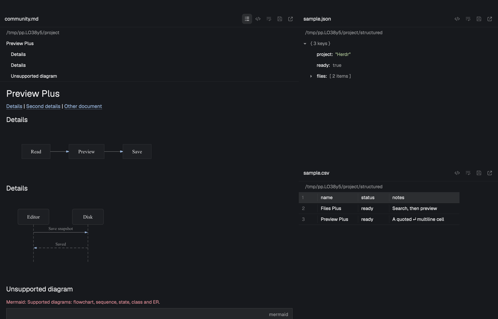

# Preview Plus

Preview Markdown with a table of contents, heading links and native Mermaid diagrams, expand JSON trees, and browse CSV/TSV tables in Herdr's Files area or a separate pane. Edit the original source, save with conflict protection, follow local links with back history, and use Fit, zoom and PDF page controls for media.



Preview Plus works without Files Plus. It can replace the standard single-folder Files panel, open a file through `pane.split` or `tab.new`, or receive selected files from [Files Plus](../files-plus/RECIPE.md).

See the [recipe](RECIPE.md) for behavior, dependencies and verification. The [implementation plan](../docs/plans/preview-plus.md) records the shared target contract and implementation evidence.

## Install

Source, QuickJS and isolated native rich-preview/handoff checks pass with Herdr 0.1.13. Physical input and additional platform/theme combinations remain unverified in this round. Requires `EditorState` with editable text, `change` events and `soft_wrap`, guarded `writeTextFile`, persistent `localStorage`, `TextView.on_link_click`, `uniform_list`, `Scrollbar`, `image`, `watchFolder` and `on_size_change`. macOS uses built-in Foundation, AppKit and PDFKit through `osascript`. Linux images require `python3`; Windows images require Python 3 as `python`. Mermaid needs no runtime Node, browser or additional installation. No service credentials are needed.

1. Check `${HERDR_APP_HOME:-$HOME/.config/herdr-app}/mods/preview-plus` for a name conflict. Stop if it exists; preserve the installed mod rather than merging files into it.
2. Copy `mods/preview-plus/`, including `mermaid.bundle.js`, `THIRD_PARTY.md` and its `licenses/`, into the app home's `mods/`. Do not copy `tests/`, `node_modules/`, generated type files or `.cache/`. Keep the package's existing `licenses/` with any redistribution too.
3. Run `herdr-app check <app-home>/mods/preview-plus`.
4. Use one of the three setups below. Clone a shipped layout with `herdr-app do layout.clone '{"name":"main","as":"my-preview"}'` before editing its structure. Preserve the surrounding Files/Changes block ids, sizes, visibility and shortcuts.

### Standalone Files panel

In a personal layout, change only the existing `files` block's content:

```json
{ "mod": "preview-plus" }
```

The focused terminal's folder appears as a lazy tree. Opening a file replaces the tree in place. Back walks followed links first, then restores the expanded tree.

### Pair with Files Plus

Install [Files Plus](../files-plus/README.md), then replace the existing `files` block with the stack below. Carry over the original block's layout sizing properties. Keep the outer `panel-body` stack and its `changes` child unchanged.

```json
{
  "id": "files",
  "type": "stack",
  "active": "files-plus-tree",
  "children": [
    {
      "id": "files-plus-tree",
      "type": "block",
      "content": { "mod": "files-plus", "props": { "previewStack": "files" } }
    },
    {
      "id": "preview-plus",
      "type": "block",
      "content": { "mod": "preview-plus", "props": { "previewStack": "files" } }
    }
  ]
}
```

The rich-preview routing contract is `.md`, `.markdown`, `.json`, `.csv`, `.tsv`, supported images and `.pdf`. Set Files Plus's open location to Internal to use the paired stack; its default can be Tab. Older Files Plus versions route only Markdown/media, so open structured files through a Preview Plus pane until the routing update is installed. The two mods share targets, not code; `{ file, root, on }` is unchanged.

### Standalone pane or tab

Use an absolute file path; `root` defaults to the file's directory and `on` defaults to `null`:

```sh
herdr-app do pane.split '{"direction":"right","mod":"preview-plus","props":{"file":"/absolute/path/README.md"}}'
herdr-app do tab.new '{"name":"Document","mod":"preview-plus","props":{"file":"/absolute/path/guide.pdf"}}'
```

Pass `on` with the machine name for remote Markdown and text. Images and PDFs are local-only. PDF rendering is macOS-only; the Open control can launch a local PDF in its system application on other platforms.

## Edit and save

Use the code icon to edit Markdown, JSON, CSV or TSV source; it becomes an eye icon that returns to Preview. Ordinary local text opens in the native editor. The top toolbar uses icon buttons with tooltips for this mode toggle, Wrap lines, Save and Open. Wrap lines stays in the same position, disabled in rich Preview and enabled in Source. A small dot beside the filename means there are unsaved changes. Save with the disk icon or `Cmd+S` on macOS (`Ctrl+S` elsewhere) while the editor has focus. No global shortcuts are installed.

Wrap lines changes only the display. The preference is remembered. Herdr currently exposes wrapping and code appearance at editor creation only, so toggling wrap or changing the code theme/font rebuilds the editor: text is preserved, but selection, scroll position and undo history may reset. Native selection, copy/paste and undo/redo are otherwise provided by Herdr.

Unsaved drafts are retained when navigating and stored locally in Herdr's mod storage for recovery after remount/restart. They are removed after saving or confirmed discard; they are not uploaded. Discard appears only while dirty: click its undo-arrow icon, then the check icon to confirm, or the cross to cancel. File watching never overwrites a draft. Save rejects a changed disk snapshot, retains the draft and shows the error; copy out any text you want to merge before discarding and reloading the external version.

Editing is limited to complete local UTF-8 text. Remote files and previews truncated at 400,000 characters remain read-only; reads also have Herdr's 1 MiB limit. Images, PDFs and binary files are not editable. Draft recovery is best effort on a crash or forced termination, and a failed recovery-storage write is shown explicitly.

## Rich previews

Markdown's Contents icon shows top-level ATX and setext headings. `#heading` and `other.md#heading` open the document from that heading; Whole document returns to the full text. Back restores the previous heading, source mode and draft. Repeated headings receive `-1`, `-2`, etc.; Unicode headings and encoded fragments work. Headings inside fenced or indented code are excluded. The host cannot scroll ordinary Markdown programmatically, so earlier sections are hidden while a heading is selected. HTML/custom heading ids and headings nested in lists/quotes are not supported.

Top-level `mermaid` fences render flowcharts (`graph`/`flowchart`), sequence, state, class and ER diagrams through bundled beautiful-mermaid 1.1.3. This is its supported syntax subset, not the full Mermaid language; pie, gantt, mindmap, HTML labels and interactive diagram links are not offered. Invalid, unsupported, oversized or unclosed diagrams show an error with their source. Wide diagrams scroll horizontally to retain readable native text. Rendering is cached by source, diagram colors and font, including same-appearance theme changes. Limits are 24 diagrams per document, 24,000 characters/300 lines per diagram and 32,768 pixels per dimension. SVG cache eviction is manual alongside the existing media cache.

JSON starts with the root expanded; click a container row to expand/collapse it. CSV uses commas or semicolons (detected outside quotes in the first record); TSV uses tabs. Quoted delimiters, escaped quotes, embedded newlines, CRLF and BOM are supported. The first table row is visually emphasized, and row numbers refer to records. Ragged rows retain all available cells. Invalid input explains the error and leaves Source available. Values/cells are read-only in Preview: it never serializes parsed JSON or rewrites CSV on Save. JSON numbers use JavaScript parsing semantics; Source retains their exact spelling.

Structured previews use virtual rows with a 10,000-row, 100-column and 64-level JSON depth limit. Displayed values are capped at 500 characters; wider cells and deeper indentation are clipped. These display limits never truncate an editable source. The existing 400,000-character text guard remains read-only. Remote structured files can be previewed but not saved.

## Development checks

Development fixtures require Node 22+; the installed mod does not use Node.

```sh
herdr-app check preview-plus/mods/preview-plus
node --experimental-vm-modules --test preview-plus/tests/*.test.mjs
node preview-plus/tests/check-mermaid.mjs
node preview-plus/tests/native-session.mjs
node preview-plus/tests/native-verify.mjs /tmp/pp.<session>/session.json
node preview-plus/tests/native-editor-verify.mjs /tmp/pp.<session>/session.json
node preview-plus/tests/native-rich-verify.mjs /tmp/pp.<session>/session.json
```

The native session command prints the exact receipt path. It starts a disposable app home and core, creates synthetic files and copies the runtime plus test drivers into that home. The verifier exercises production handlers and actual rendering; screenshots still require visual inspection. It does not change the user's app home, layout or key bindings. Close the disposable instance with `HERDR_APP_HOME=<receipt-app-home> herdr-app do app.quit`; its temporary core and files are scoped by the environment recorded in the receipt.

To reproduce the checked-in renderer from the public npm lock, use Node 22+:

```sh
cd preview-plus
npm ci --ignore-scripts
npm run build
npm run build -- --check
```

The build applies asserted QuickJS compatibility patches before bundling. `check-mermaid.mjs` executes five diagram families during initialization in a disposable `herdr-app check` root, without starting a core or a visible app session. It proves execution, not SVG painting. See [third-party notices](mods/preview-plus/THIRD_PARTY.md) for source, licenses and changes.
