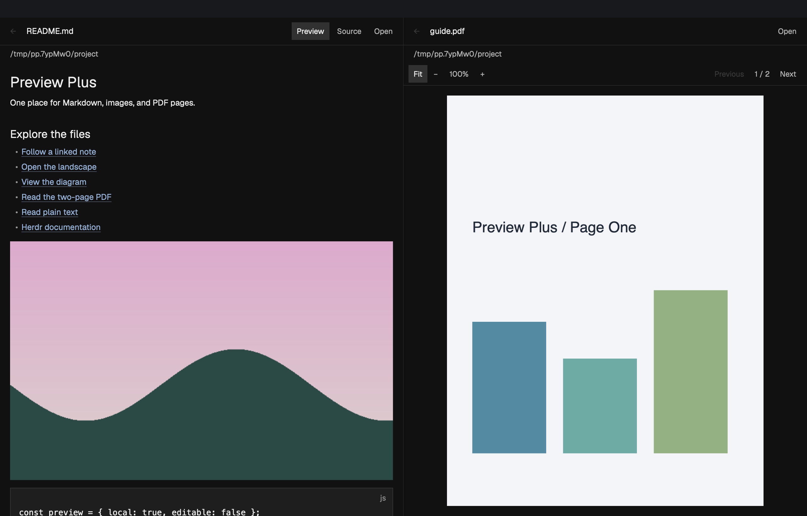

# Preview Plus

Read Markdown, inspect images and browse PDF pages inside Herdr. Use the mod as the Files panel, receive file selections from Files Plus, or open a file in its own pane. Markdown has Preview and Source controls; local links stay in the viewer and Back retraces them.



The preview is an unedited `herdr-app shot` of a disposable Herdr window using synthetic documents. Preserve its sRGB metadata.

## What you see

The 44px header shows Back, the file name, Markdown's Preview/Source controls and Open. A 28px path row shows the containing directory. A standalone Files tree has Refresh in the header, 30px file rows, 18px nesting and Git status letters at the right. The layout owns the panel width; no layout or keys are installed automatically.

An image or PDF adds a wrapping toolbar with Fit, −, 100% and +. PDFs also show Previous, the current/total page count, and Next. The image canvas scrolls in both directions when zoomed. Fit uses the current viewport with 16px padding and preserves the aspect ratio.

Use 13px interface text and 12px secondary text, 0.5px separators, no shadows and no animations. Colors follow [Radix scale roles](https://www.radix-ui.com/colors/docs/palette-composition/understanding-the-scale): Gray 1–3 backgrounds, Gray 4 hover, Gray 5 selection, Gray 6 separators and Gray 11–12 text. Red, Green, Amber, Blue and Purple 11 carry errors, Git states and source syntax. Choose the light or dark palette using `settings().dark`. Native editor and rich-text internals use Herdr's theme.

## How it behaves

- With no `file` or `previewStack` prop, show the focused terminal's single-folder tree. Load folders lazily; sort directories first, include hidden entries, omit `.git` and avoid recursing through symlink directories. Keep expansion state while a file replaces the tree. Back from the first file returns to that tree.
- With `previewStack`, read `shared("preview-plus.target")[spaceId]`. At the root of history, Back selects `files-plus-tree` in that stack. Leave the source tree and other shared state alone.
- With `file`, show that absolute path directly. Default `root` to its directory and `on` to local. A pane's initial target has no parent tree, so Back is disabled until a link adds history.
- Render `.md` and `.markdown` through native `TextView.markdown`; Source uses a retained read-only `Editor`. Plain text uses the same editor. Truncate text after 400,000 characters, retain the source for Preview/Source switching, and show explicit missing, unreadable and binary-file states.
- Resolve local Markdown links against the current file's directory, including `..`, encoded names, and paths with spaces. Carry the owning root and machine through navigation. Save each previous target's source mode, page and zoom in memory. HTTP(S) links call `cx.open_url` without adding history. Fragment-only links leave the current view in place.
- Render local Markdown image references as native image blocks among the text blocks. Support inline and reference image syntax, angle-delimited destinations, escaped parentheses, optional titles and linked images. Preserve fenced/inline code. Reuse reference definitions in each text block so links still resolve across images. Clicking an image opens it, or follows its enclosing link. Images preserve their aspect ratio and fit the document width. HTML `` syntax and precise inline-image/list/table composition are not implemented.
- Stage `.png`, `.jpg`, `.jpeg`, `.webp` and `.svg` under `mods/preview-plus/.cache/`. Derive the filename from source path, modification time and size. Keep source bytes unchanged. Fit is the default; zoom ranges from 5% to 800%. Open launches the local system application.
- On macOS, use PDFKit to inspect the page count and rasterize only the requested page, never the entire PDF. Cache each page separately. Limit the raster's longest edge to 2,048 pixels and its scale to 2×; zoom enlarges that raster. Clamp the page if an external edit reduces the page count. Reject locked, empty or unreadable PDFs with a visible error.
- Watch the displayed local file and local images referenced by Markdown. Resolve parent-directory aliases to physical paths when comparing native events. Reload modified, atomically replaced, deleted and restored files. Queue a reload if an update arrives during a read/conversion. Ignore unrelated file events. Remote trees refresh every ten seconds and offer manual Refresh; remote previews reload when reopened or sent `preview-plus.refresh`.
- Apply async results only when the target request, file, machine and active space still match. Switching a target resets link history. Release retained editors when the target or view closes.

Agent working, blocked, done and idle displays remain the surrounding Herdr UI's responsibility.

## Built from

```text
preview-plus/
  RECIPE.md, README.md, preview.png, licenses/
  mods/preview-plus/
    main.js, tree.js, paths.js, markdown.js, media.js, palette.js, mod.json
  tests/
```

Default-export a class extending `View`. `main.js` owns mode selection, request identity, source state, history, watchers, page/zoom controls and rendering. `tree.js` owns lazy enumeration and Git marks. `paths.js` normalizes paths and resolves links. `markdown.js` extracts local image references without rewriting code examples. `media.js` stages images and renders a single PDF page through argument-separated external calls. `palette.js` owns the Radix colors.

Use GPUI `div`, `image`, `v_flex`, `h_flex`, `TextView`, `EditorState` and `Editor`. Use `cx.spawn` for work, callback-owned contexts for updates, and `on_size_change` for viewport measurements. Herdr supplies `props`, `shared`, `spaces`, `panes`, `focused`, `settings`, `window`, `appHome`, `exec`, `readTextFile`, `watchFolder`, `nextCommand` and `run`. Only paired Back runs `layout.select`; it never writes the shared target.

The mod manifest is `{ "place": "none" }`. See the [installation instructions](README.md) for the three supported layouts and pane commands. There are no cross-mod code imports and no shortcut changes. Optional command names are `back`, `source`, `preview`, `refresh`, `fit`, `zoom-in`, `zoom-out`, `next` and `previous`, delivered as `preview-plus.<command>`.

### External programs and files

The mod reads only selected files, referenced local images, displayed directories and Git metadata. It writes only its app-home cache. No service credentials are required. Preview Plus makes no HTTP requests itself; opening an HTTP(S) link uses the system browser.

macOS image staging uses `osascript -l JavaScript` with Foundation and AppKit. PDFs additionally use PDFKit. Linux/Windows image staging uses Python 3's standard library to read PNG/JPEG/WebP/SVG dimensions and copy bytes. Directory browsing uses `sh` on POSIX machines and PowerShell locally on Windows; Git marks use `git`, and physical-directory matching uses `pwd -P` on POSIX. Open uses `open`, `xdg-open` or `explorer.exe` for the local platform. Pass file paths as arguments; never splice them into executable JavaScript or shell code.

The cache contains copies of viewed files. It is local, disposable and excluded from Git. Close viewers before removing `.cache/`; it is recreated on demand. Cache eviction is manual.

### Attribution

Directory enumeration, bounded browsing and Git-status handling adapt the Files mod bundled with [Herdr 0.1.11](https://github.com/herdrdev/herdr-app); see [Apache-2.0](licenses/Herdr-APACHE-2.0.txt). The changes add the standalone preview tree, request ownership and local-file integration. Palette values come from [Radix Colors](https://github.com/radix-ui/colors); see its [MIT notice](licenses/Radix-MIT.txt). Test landscapes, diagrams and PDFs are original generated fixtures. No repository license is selected or changed.

## Watch out

Herdr runs native GPUI JavaScript without a DOM, Node APIs or `setTimeout`. Use the installed type files as the API contract. A passing `check` covers only initial rendering; it does not prove deferred views, media decoding or interactions.

A native 0.1.11 probe rendered the same cached PNG through `image()` while both Markdown and HTML TextViews omitted it, including with data URIs. Therefore text remains in `TextView` and local images use native image blocks in the same scroll region. Do not replace this with a path-only rewrite without verifying the real window again. Upstream [TextView image documentation](https://gpui-kit.com/component/text-view/#images) describes URI loading, but the bundled runtime's observed behavior is the acceptance boundary.

Media is local-only, and PDF rendering is macOS-only. Remote text uses `readTextFile(..., { on })`. Remote images, missing inline images, unsupported PDFs and failed conversions have visible states. Source reads are also subject to Herdr's 1 MiB UTF-8 limit. File trees stop at 500 entries per folder, 5,000 total and depth 40. Very large images remain subject to the native decoder's resource limits.

## Done when

Run `herdr-app check preview-plus/mods/preview-plus`. Run `node --experimental-vm-modules --test preview-plus/tests/preview.test.mjs` for navigation, read ownership, source/error/truncation states, watcher matching and real image/PDF helpers. On macOS, run the disposable session and native verifier from the README, then inspect the screenshots. The verifier calls production handlers; it does not synthesize mouse clicks.

Acceptance requires an expanded standalone tree, Markdown Preview/Source, a followed note/image and correct Back history, a visible native document image, fit/100%/zoom, PNG/SVG display, both PDF pages, external-file updates/deletion/recovery, paired Files Plus handoff and return, a standalone mod pane, and `herdr-app status` with `errors: []`. Capture `preview.png` with `herdr-app shot` from the final runtime. The implementation plan records the actual environment and completed checks.
